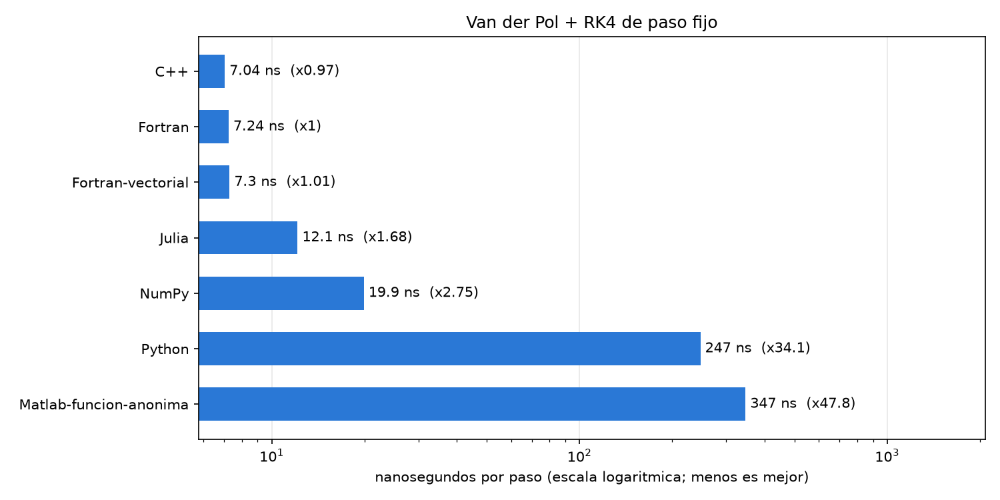

# Unidad 00 · Propaganda

Fortran no es más rápido que otros lenguajes compilados: bien escritos, Fortran y C++ producen el
mismo código. La ventaja es que un programa de cálculo escrito de la forma más natural en Fortran
suele ser rápido, y el mismo estilo en otros lenguajes puede ser mucho más lento.

## Un lenguaje de matemáticos

El nombre viene de *FORmula TRANslation*. Lo diseñó en IBM un equipo de matemáticos y científicos
dirigido por John Backus para escribir fórmulas en el ordenador de forma parecida a como se escriben
en papel. Los vectores y las matrices forman parte del lenguaje y `c = a + 2*b` suma vectores sin
bucles. En cambio, Fortran está peor adaptado a la programación genérica: texto, estructuras de datos
complejas o aplicaciones web.

## Medidas

El mismo programa en varios lenguajes: Runge–Kutta de orden 4 con paso fijo para Van der Pol, desde
muchas condiciones iniciales.

| Versión | ns por paso | Veces Fortran |
|---|---:|---:|
| C++ | 7,0 | 0,97 |
| Fortran | 7,2 | 1,00 |
| Fortran, con arrays y funciones que devuelven vectores | 7,3 | 1,01 |
| Julia | 12,1 | 1,68 |
| NumPy, vectorizado | 19,9 | 2,75 |
| Python puro | 247 | 34 |
| Matlab, con vectores y función anónima | 347 | 48 |

Intel Core i7-14700, Windows 11, GCC 14.2, Julia 1.13, Python 3.12, NumPy 2.5 y Matlab R2025b. Todas
las versiones dan el mismo resultado salvo redondeo.

La versión de Fortran con arrays pequeños y funciones que devuelven vectores tarda lo mismo que la
escrita con escalares. En Matlab y en Python ese estilo multiplica el tiempo.

## Otros datos

Un programa en FORTRAN 77 compila hoy sin cambios. BLAS y LAPACK, que usan Matlab, Julia y NumPy, se
escribieron en Fortran, y también WRF, VASP y Quantum ESPRESSO. Fortran puede llamarse desde Julia,
Python y C.

## Cuándo no usarlo

Texto, interfaces, exploración de datos y aprendizaje automático se resuelven mejor con Python o
Julia. El criterio razonable es escribir en Fortran el núcleo numérico que tarda horas y usar otro
lenguaje para el resto.
