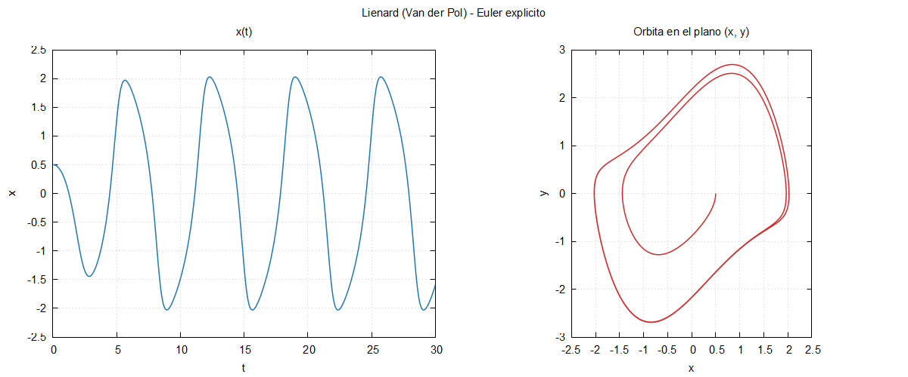

# Bloque 02 · Euler explícito para la ecuación de Liénard

Primer programa "de verdad": un modelo, un solver y un programa principal,
cada uno en su sitio; parámetros en un archivo de entrada; datos en
columnas y una figura con gnuplot.

## El problema

La ecuación de Liénard `x'' + f(x) x' + g(x) = 0`, escrita como sistema:

```
x' = y
y' = -f(x)*y - g(x)
```

Por defecto es **Van der Pol**: `f(x) = mu*(x**2 - 1)`, `g(x) = x`.
El método es **Euler explícito** de paso fijo: `u_{k+1} = u_k + h F(t_k, u_k)`.

## Compilar y ejecutar

```bash
make run          # compila (release), ejecuta con entrada.nml y dibuja
make run-debug    # lo mismo en modo debug
make plot         # solo vuelve a dibujar
make clean
```

Con otro archivo de entrada: `./euler otro.nml` (en PowerShell, `.\euler otro.nml`).
Con fpm: `fpm run` o `fpm run -- otro.nml`.

Salida: `resultados/euler.dat` (columnas `t x y`) y `resultados/euler.png`.



## Archivos

| Archivo | Contenido |
|---|---|
| `src/modelo_lienard.f90` | `f`, `g`, el campo vectorial y su jacobiano analítico |
| `src/solver_euler.f90` | Euler explícito de paso fijo |
| `src/sistema.f90` | crear carpetas y llamar a gnuplot (Windows y Linux) |
| `app/principal.f90` | lee el namelist, integra, escribe y dibuja |
| `entrada.nml` | parámetros: `mu`, `h`, `t_final`, `x0`, `y0`, `archivo_salida` |
| `graficar.gp` | script de gnuplot: x(t) y órbita en (x, y) |
| `error_indice.f90` | demostración de `-fcheck=all` |

## Cambiar el modelo

Edita `f`, `g` y sus derivadas `df`, `dg` en `src/modelo_lienard.f90`.
Las derivadas solo hacen falta para el jacobiano (bloque 03).

Los bloques 03 y 04 **usan este mismo archivo**: el modelo está definido
en un único sitio. Si lo cambias, cambian los tres bloques.

> **Plano de Liénard.** Con `F(x) = ∫₀ˣ f(s) ds` y el cambio
> `w = y + F(x)`, el sistema queda `x' = w - F(x)`, `w' = -g(x)`.
> Para Van der Pol, `F(x) = mu*(x**3/3 - x)`: la nulclina `w = F(x)` es la
> cúbica que explica las oscilaciones de relajación cuando `mu` es grande.

## Conceptos de Fortran que aparecen

### Módulos y archivos `.mod`

Un `module` agrupa tipos, constantes y procedimientos. Quien lo necesita
escribe `use modelo_lienard`. Al compilar un módulo, gfortran genera un
archivo **`.mod`**: la "interfaz compilada" del módulo.

| | Fortran | C++ | Julia |
|---|---|---|---|
| Interfaz | `.mod`, **generado** por el compilador | `.h`, escrito a mano | no hay: todo es código fuente |
| Importar | `use modulo, only: f` | `#include "f.h"` | `using .Modulo: f` |
| Visibilidad | `private` / `public` | `static`, `namespace` | `export` |
| Consecuencia | **orden de compilación**: el módulo antes que quien lo usa | ninguna | ninguna |

Por eso el `Makefile` declara qué objeto depende de cuál, y por eso fpm
existe: lo averigua solo. En este curso los módulos son `private` por
defecto y se exporta explícitamente lo necesario con `public`.

### `kind` y `real64`

```fortran
use, intrinsic :: iso_fortran_env, only: real64
real(real64) :: x = 0.5_real64      ! doble precisión (64 bits)
```

`real` a secas es de **32 bits**. El sufijo `_real64` es importante:
`0.1` es una constante de simple precisión y `0.1_real64` de doble.
Equivale a `Float64` en Julia y a `double` en C++.

### `intent`

```fortran
subroutine integrar_euler(u0, p, h, n_pasos, t, u)
    real(real64), intent(in) :: u0(:)                    ! solo se lee
    real(real64), allocatable, intent(out) :: t(:), u(:,:) ! solo se escribe
```

`intent(in)`, `intent(out)` e `intent(inout)` documentan el contrato y el
compilador lo **comprueba**: modificar un argumento `intent(in)` es un error
de compilación. Es como `const&` en C++, pero obligatorio en la práctica.
Los argumentos se pasan por referencia: no hay copias de los arrays.

### `namelist`: archivos de entrada sin escribir un parser

```fortran
namelist /parametros/ mu, h, t_final, x0, y0, archivo_salida
read(unidad, nml=parametros)
```

lee un archivo como `entrada.nml`. El orden no importa, se admiten
comentarios con `!` y las variables que no aparecen conservan su valor por
defecto. Ideal para cambiar parámetros **sin recompilar**.

### Argumentos de la línea de órdenes

```fortran
if (command_argument_count() >= 1) then
    call get_command_argument(1, archivo_entrada)
else
    archivo_entrada = "entrada.nml"
end if
```

Así se pueden lanzar varios experimentos (`entrada_mu5.nml`, ...) con el mismo ejecutable.

### Release frente a debug

| Modo | Opciones | Para qué |
|---|---|---|
| `make` | `-O3 -march=native` | producción: rápido, sin red |
| `make debug` | `-g -O0 -fcheck=all -fbacktrace -Wall -Wextra -ffpe-trap=invalid,zero,overflow` | desarrollo: lento, detecta errores |

- `-fcheck=all`: comprueba índices fuera de rango, punteros, etc.
- `-fbacktrace`: si algo falla, dice archivo y línea.
- `-ffpe-trap=invalid,zero,overflow`: para el programa en el primer `NaN`,
  división por cero o desbordamiento, en lugar de propagar basura.
- `-Wall -Wextra`: avisos. Se añade `-Wno-unused-dummy-argument` porque el
  campo recibe `t` aunque el sistema sea autónomo.

**Regla práctica**: desarrolla en debug; cambia a release solo cuando funcione.

```bash
make demo-error
```

compila `error_indice.f90` en ambos modos. La matriz `m(5,2)` se recorre
hasta la fila 6:

```
===== release: sin comprobaciones =====
Suma de la primera columna = 115.0          <-- falso, y sin avisar
===== debug: -fcheck=all =====
At line 26 of file error_indice.f90
Fortran runtime error: Index '6' of dimension 1 of array 'm' above upper bound of 5
```

En release, `m(6,1)` lee en realidad `m(1,2) = 100`, porque Fortran guarda
las matrices **por columnas**.

## Ejercicio

1. Ejecuta con `h = 0.1` y con `h = 0.001`. ¿Qué le pasa a la órbita con
   el paso grande? (Pista: Euler explícito no conserva bien las órbitas cerradas.)
2. Crea `entrada_mu5.nml` con `mu = 5`, `t_final = 50` y
   `archivo_salida = 'resultados/euler_mu5.dat'`, y ejecútalo con
   `./euler entrada_mu5.nml`. Observa las oscilaciones de relajación.
3. Cambia `g(x)` por `x + x**3` (oscilador de Duffing amortiguado no
   linealmente). Recuerda actualizar `dg`. Después, deja el modelo como estaba
   (`git checkout src/modelo_lienard.f90`).
