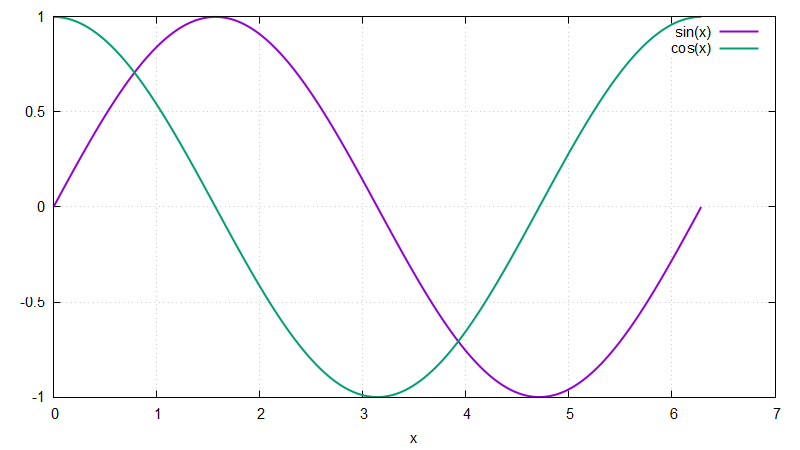

# Bloque 04 · Arrays y archivos

Los arrays son la razón de ser de Fortran: operaciones sobre arrays
completos sin bucles, cortes como en Matlab o Julia y matrices guardadas
por columnas. Después, escribir datos en un archivo y dibujarlos con
gnuplot, que es lo que haremos con todas las simulaciones del curso.

```bash
gfortran -Wall arrays.f90 -o arrays
./arrays
gfortran -Wall tabla.f90 -o tabla
./tabla
gnuplot graficar.gp
```

## `arrays.f90`

```fortran
real(real64) :: v(5), w(5)              ! tamaño fijo; índices 1..5
real(real64) :: a(2, 3)                 ! 2 filas, 3 columnas
real(real64), allocatable :: x(:)       ! tamaño decidido al ejecutar

v = [1.0_real64, 2.0_real64, 3.0_real64, 4.0_real64, 5.0_real64]
w = 2 * v + 1                           ! sin bucle
```

Salida (resumida):

```
v        =   1.0   2.0   3.0   4.0   5.0
2*v + 1  =   3.0   5.0   7.0   9.0  11.0
v * w    =   3.0  10.0  21.0  36.0  55.0
...
v(5:1:-1) =   5.0   4.0   3.0   2.0   1.0

a =
   1.0   3.0   5.0
   2.0   4.0   6.0
a(:, 2) (columna 2) =   3.0   4.0
matmul(a, [1, 1, 1]) =   9.0  12.0

x(0:n) =  0.00  0.25  0.50  0.75  1.00
lbound(x) = 0   ubound(x) = 4
```

| Idea | Fortran | Julia | Matlab |
|---|---|---|---|
| Elemento | `v(2)` | `v[2]` | `v(2)` |
| Corte | `v(2:4)`, `v(1:5:2)` | `v[2:4]`, `v[1:2:5]` | `v(2:4)`, `v(1:2:5)` |
| Columna | `a(:, 2)` | `a[:, 2]` | `a(:, 2)` |
| Elemento a elemento | `v * w` | `v .* w` | `v .* w` |
| Producto matricial | `matmul(a, b)` | `a * b` | `a * b` |
| Producto escalar | `dot_product(v, w)` | `dot(v, w)` | `dot(v, w)` |
| Tamaño | `size(v)`, `shape(a)` | `length(v)`, `size(a)` | `numel(v)`, `size(a)` |
| Rango | `[(i, i = 1, n)]` | `1:n` | `1:n` |

- **Primer índice**: 1 por defecto, pero se elige: `x(0:n)` tiene `n + 1`
  elementos, de `x(0)` a `x(n)`. Muy cómodo para escribir `u(0), ..., u(n)`
  como en las fórmulas.
- **Por columnas**: `a(1,1), a(2,1), a(1,2), ...` están seguidos en
  memoria (como en Julia y Matlab, al revés que en C/C++). `a(:, j)`, una
  columna, es contigua; `a(i, :)`, una fila, no. Por eso, en el curso, cada
  estado de una trayectoria se guarda como **columna**: `u(:, k)`.
- **`allocatable`**: `allocate(x(0:n))` reserva memoria y se libera sola
  cuando la variable deja de existir. Además, asignar un array entero a uno
  `allocatable` lo (re)dimensiona automáticamente.
- Casi todas las funciones intrínsecas (`sqrt`, `sin`, `abs`...) actúan
  elemento a elemento sobre arrays. Reducciones: `sum`, `product`,
  `maxval`, `minval`, `maxloc`, `norm2`, `any`, `all`, `count`.

## `tabla.f90`: escribir un archivo

```fortran
open(newunit=unidad, file="tabla.dat", status="replace", action="write")
write(unidad, '(a)') '#          x              sin(x)              cos(x)'
do i = 0, n
    write(unidad, '(3es20.10)') x(i), sin(x(i)), cos(x(i))
end do
close(unidad)
```

- `open` asocia un archivo a una **unidad** (un número); `newunit=` deja que
  Fortran elija uno libre. `status="replace"` lo crea o lo sobrescribe.
- `write(unidad, formato)` es como `print` pero hacia el archivo.
  `3es20.10`: tres reales en notación científica, 20 columnas y 10 decimales.
- La primera línea empieza por `#`: gnuplot (y `readdlm` de Julia, `load`
  de Matlab con `CommentStyle`, `numpy.loadtxt`) la ignoran.

`graficar.gp` lee las columnas y dibuja:

```gnuplot
plot 'tabla.dat' using 1:2 with lines title "sin(x)", \
     'tabla.dat' using 1:3 with lines title "cos(x)"
```



## Ejercicios

1. En `arrays.f90`, calcula la norma de `v` de tres formas:
   `sqrt(sum(v**2))`, `sqrt(dot_product(v, v))` y `norm2(v)`.
2. Añade a `tabla.f90` una cuarta columna con `sin(x)**2 + cos(x)**2 - 1`
   y dibújala. ¿De qué orden es? (Compáralo con `epsilon(1.0_real64)`.)
3. Haz que `n` se pida al usuario: declara `integer :: n`, quita el
   `parameter`, lee con `read *, n` y usa `allocatable` para `x`.
