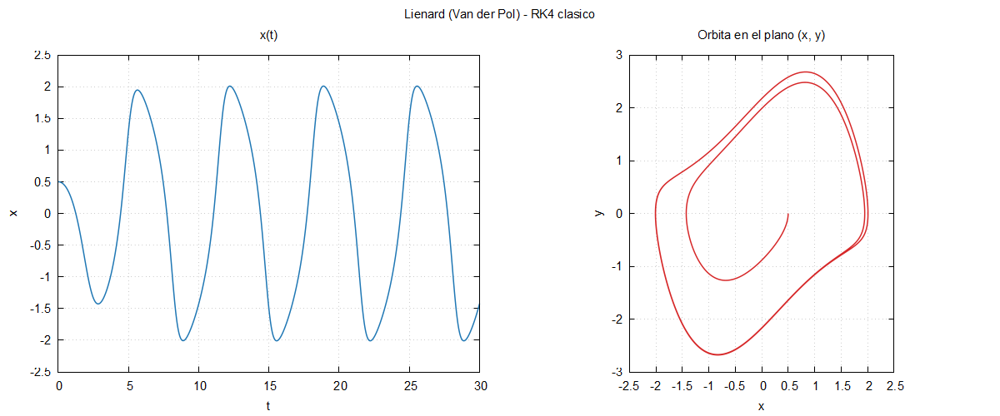
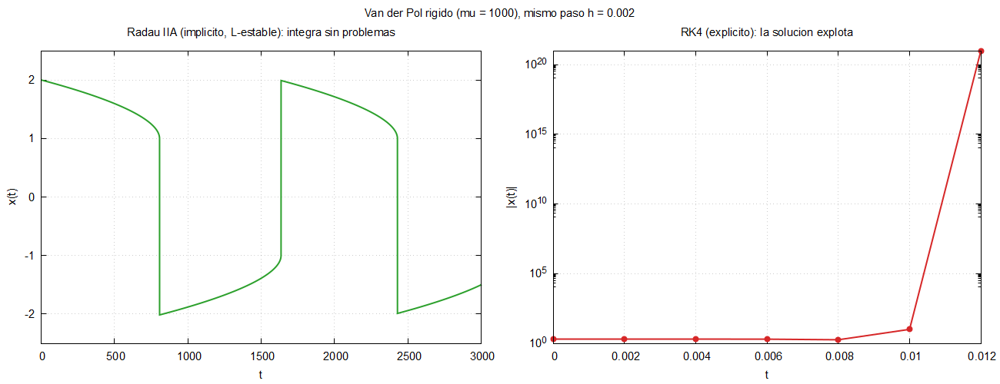
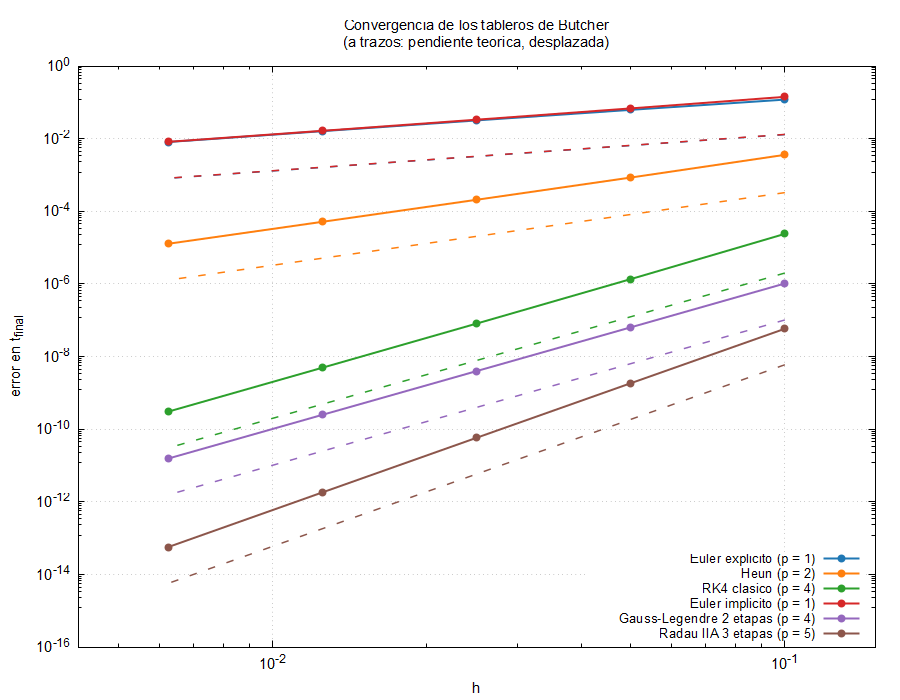

# Bloque 04 · Runge–Kutta general con tableros de Butcher

Un único solver para **cualquier** método Runge–Kutta de paso fijo,
explícito o implícito. El método se describe en un archivo de texto (su
tablero de Butcher) y el campo vectorial se pasa como un puntero a
procedimiento: el solver no sabe qué método ni qué modelo está usando.

## Compilar y ejecutar

```bash
make run            # RK4 con entrada.nml
make rigido         # demostración de rigidez: RK4 frente a Radau IIA, mu = 1000
make convergencia   # test de convergencia de los 6 tableros
make debug          # modo debug (ejecutables *_debug)
make clean
```

Cambiar de método sin tocar `entrada.nml`: el segundo argumento sustituye al tablero.

```bash
./rk_butcher entrada.nml tableros/gauss_legendre2.txt
```

Con fpm: `fpm run rk_butcher -- entrada.nml tableros/radau_iia3.txt` y `fpm run convergencia_rk`.

## Archivos

| Archivo | Contenido |
|---|---|
| `src/tablero_butcher.f90` | tipo derivado `tablero`, lectura y validación |
| `src/solver_rk.f90` | interfaces abstractas, `problema_edo`, paso RK explícito/implícito, integración |
| `src/algebra_lineal.f90` | eliminación gaussiana con pivoteo parcial (sin LAPACK) |
| `app/principal.f90` | programa principal |
| `convergencia/convergencia.f90` | test de convergencia (lo usa la integración continua) |
| `tableros/*.txt` | los métodos |
| `../03_euler_lienard/src/` | el **modelo** y las utilidades se reutilizan del bloque 03 |

## Formato de los tableros

```
# Runge-Kutta clásico de orden 4        <- comentarios con '#', en cualquier sitio
RK4 clasico                             <- nombre
4                                       <- número de etapas s
4                                       <- orden teórico
0.0  0.0  0.0  0.0                      <- s filas de A
0.5  0.0  0.0  0.0
0.0  0.5  0.0  0.0
0.0  0.0  1.0  0.0
0.16666666666666666  0.33333333333333333  0.33333333333333333  0.16666666666666666   <- b
0.0  0.5  0.5  1.0                      <- c
```

Al leerlo se comprueba la dimensión (cada fila debe tener `s` números) y se
avisa si `c_i ≠ Σ_j a_ij` o si `Σ b_i ≠ 1`.

| Tablero | Tipo | Etapas | Orden |
|---|---|---|---|
| `euler_explicito.txt` | explícito | 1 | 1 |
| `heun.txt` | explícito | 2 | 2 |
| `rk4.txt` | explícito | 4 | 4 |
| `euler_implicito.txt` | implícito, L-estable | 1 | 1 |
| `gauss_legendre2.txt` | implícito, A-estable, simpléctico | 2 | 4 |
| `radau_iia3.txt` | implícito, L-estable | 3 | 5 |

Coeficientes de Gauss–Legendre y Radau IIA: Hairer y Wanner, *Solving
Ordinary Differential Equations II*, sección IV.5, escritos con 17 cifras.

## Cómo funciona el solver

- **Explícito** (A estrictamente triangular inferior, se detecta solo):
  `k_i = F(t + c_i h, u + h Σ_{j<i} a_ij k_j)` y `u_{n+1} = u_n + h Σ b_i k_i`.
  En Fortran, con operaciones sobre arrays:

  ```fortran
  k(:, i) = prob%campo(t + tab%c(i)*h, u + h*matmul(k(:, 1:i-1), tab%a(i, 1:i-1)), prob%p)
  u_nuevo = u + h * matmul(k, tab%b)
  ```

- **Implícito**: las incógnitas `z_i = h Σ_j a_ij F(t + c_j h, u + z_j)`
  forman un sistema no lineal de dimensión `n·s`, que se resuelve con
  **Newton** usando el **jacobiano analítico** del modelo. La matriz de
  Newton tiene bloques `δ_ij I − h a_ij J_j` y se resuelve con la
  eliminación gaussiana de `algebra_lineal`. Tolerancia y número máximo de
  iteraciones en el namelist (`tol_newton`, `max_iter_newton`). Si Newton
  no converge, el programa lo dice (instante y número de iteraciones) y se
  detiene. Si el método es rígidamente preciso (`b` = última fila de `A`,
  como Radau IIA), `u_{n+1} = u_n + z_s`, sin volver a evaluar `F`.

**Comprobación**: Euler explícito de este bloque reproduce **bit a bit** la
salida del bloque 03 (mismos parámetros, mismo modo de compilación):

```bash
./rk_butcher entrada.nml tableros/euler_explicito.txt
cmp <(grep -v '^#' resultados/euler_explicito.dat) <(grep -v '^#' ../03_euler_lienard/resultados/euler.dat)
```

(entre release y debug los resultados difieren en las últimas cifras: con
`-O3 -march=native` el compilador usa instrucciones FMA, que redondean distinto).



## Demostración de rigidez

Van der Pol con `mu = 1000` (`entrada_rigido.nml`), **el mismo paso** `h = 0.002`:

```bash
make rigido
```

| Método | Resultado (valores medidos) |
|---|---|
| RK4 | explota: `|x| ~ 1e20` en `t = 0.012`, `Inf` en `t = 0.014` |
| Radau IIA | integra hasta `t = 3000` (1,5 millones de pasos) en ~2,5 s; 2 iteraciones de Newton por paso |



Por qué: cerca de `x = 2` el jacobiano tiene un autovalor `≈ −mu(x² − 1) ≈ −3000`.
La región de estabilidad de RK4 corta el eje real en `≈ −2,79`, así que
necesita `h ≲ 9·10⁻⁴`; de hecho, con `h = 9·10⁻⁴` explota en el primer
salto y es estable con `h = 5·10⁻⁴`. Radau IIA es L-estable: no tiene esa
restricción. Precisión: Radau con `h = 0.002` da `x(3000) = −1.499`; la
referencia (RK4 con `h = 10⁻⁴`, 30 millones de pasos) da `−1.511`
(el error es de fase, en la parte lenta del ciclo). Con `h = 0.01`, Newton
deja de converger en el salto rápido (`t ≈ 807`): un implícito no hace
milagros si el paso es mucho mayor que la escala del salto.

En modo debug, `-ffpe-trap=overflow` detiene RK4 en el primer desbordamiento
(`SIGFPE`), que es justo lo que se quiere al depurar.

## Test de convergencia

```bash
make convergencia
```

Van der Pol con `mu = 1` (no rígido), `t_final = 2`, pasos `h = 0.1, 0.05, …, 0.00625`.
El error en `t_final` se mide frente a una referencia (RK4 con `h = 10⁻⁴`).
El orden observado es la pendiente del ajuste por mínimos cuadrados de
`log(error)` frente a `log(h)` con los 3 pasos más finos cuyo error supera
`10⁻¹²` (por debajo domina el redondeo). Resultado:

```
  Tablero                       orden teorico   orden observado
                 Euler explicito       1              0.99    OK
                            Heun       2              2.01    OK
                     RK4 clasico       4              4.03    OK
                 Euler implicito       1              1.01    OK
         Gauss-Legendre 2 etapas       4              4.00    OK
              Radau IIA 3 etapas       5              4.99    OK
```

Si algún orden se desvía más de 0,3 del teórico, el programa termina con
código de error: así lo usa la integración continua (`.github/workflows/ci.yml`).
La figura la genera un script de gnuplot que escribe el propio programa
(`resultados/convergencia.gp`).



## Conceptos de Fortran que aparecen

### Tipos derivados con componentes `allocatable`

```fortran
type :: tablero
    character(len=:), allocatable :: nombre
    integer :: s = 0
    real(real64), allocatable :: a(:, :), b(:), c(:)
    logical :: explicito = .false.
end type tablero
```

Como un `struct` de C++ o un `struct` de Julia. Las componentes
`allocatable` se reservan con `allocate` (o al asignar: `prob%p = [mu]`) y
**se liberan solas** al salir de ámbito. No hay fugas de memoria ni
`delete`, y no hace falta un `std::vector`: el array dinámico es parte del lenguaje.

### Interfaces abstractas y punteros a procedimiento

```fortran
abstract interface
    pure function campo_vectorial(t, u, p) result(du)
        import :: real64
        real(real64), intent(in) :: t, u(:), p(:)
        real(real64) :: du(size(u))
    end function campo_vectorial
end interface

type :: problema_edo
    procedure(campo_vectorial), pointer, nopass :: campo => null()
    procedure(jacobiano_campo), pointer, nopass :: jacobiano => null()
    real(real64), allocatable :: p(:)
end type problema_edo
```

y en el programa principal:

```fortran
prob%campo => campo_lienard
prob%jacobiano => jacobiano_lienard
```

La interfaz abstracta es la "firma" de la función (como
`std::function<Vec(double, const Vec&)>` en C++, o simplemente pasar una
función como argumento en Julia). El compilador comprueba que
`campo_lienard` tiene exactamente esa firma. Para integrar otro sistema
basta escribir otra función con la misma interfaz.

### `pure`

Una función `pure` no tiene efectos secundarios: no modifica sus
argumentos `intent(in)`, ni variables globales, ni hace E/S. El compilador
lo **verifica**, y a cambio puede optimizar y paralelizar con más libertad
(es requisito, por ejemplo, para llamarla dentro de `do concurrent`).
Aquí son `pure` el modelo, el paso RK y la eliminación gaussiana.

### Índices desde 1 y límites arbitrarios

Por defecto los arrays empiezan en 1 (como en Julia y Matlab, no como en
C++), pero se puede elegir: `u(2, 0:n_pasos)` hace que `u(:, k)` sea el
estado en `t_k`, con `k = 0, ..., n_pasos`, igual que en las fórmulas.
Los cortes `k(:, 1:i-1)` admiten rangos vacíos (`1:0`): `matmul` devuelve
entonces ceros y la primera etapa no necesita un caso especial.

### Almacenamiento por columnas

| | Fortran | Julia | Matlab | C++ (`double a[n][m]`) |
|---|---|---|---|---|
| Orden en memoria | por columnas | por columnas | por columnas | por filas |
| Bucle interno rápido | primer índice | primer índice | primer índice | último índice |

Por eso las etapas son **columnas** `k(:, i)` (cada una contigua en
memoria) y la eliminación gaussiana actualiza por columnas
(`m(k+1:n, j) = m(k+1:n, j) - l(k+1:n)*m(k, j)`). Recorrer una matriz
grande "al revés" puede ser varias veces más lento por los fallos de caché.

## Ejercicio

Añade el **RK3 de Kutta** (orden 3):

```
  0   | 0     0    0
  1/2 | 1/2   0    0
  1   | -1    2    0
  ----+---------------
      | 1/6   2/3  1/6
```

1. Crea `tableros/kutta3.txt` y ejecútalo con `./rk_butcher entrada.nml tableros/kutta3.txt`.
2. Añádelo a `convergencia/convergencia.nml` (`tableros(7) = 'tableros/kutta3.txt'`)
   y comprueba que el orden observado es ≈ 3.
3. Pregunta: si ajustas la pendiente con **todos** los pasos (desde `h = 0.1`), sale ≈ 2,7.
   ¿Por qué? (Mira los cocientes de errores consecutivos: con `h` grande aún no
   se está en el régimen asintótico `error ≈ C h³`.)

<details>
<summary>Solución</summary>

```
# RK3 de Kutta (orden 3)
RK3 de Kutta
3
3
 0.0  0.0  0.0
 0.5  0.0  0.0
-1.0  2.0  0.0
0.16666666666666666  0.66666666666666667  0.16666666666666666
0.0  0.5  1.0
```

Orden observado: 2.93.
</details>
