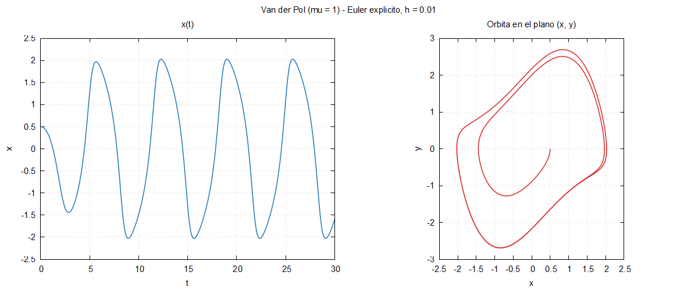

# Bloque 05 · Euler para Van der Pol, en un archivo

Primera simulación: el oscilador de **Van der Pol** con el método de
**Euler explícito**. Todo cabe en un archivo de 50 líneas y solo usa lo
visto en los bloques 03 y 04, más una cosa nueva: **funciones**.

```
x' = y
y' = -mu*(x**2 - 1)*y - x          u = (x, y),   u_{k+1} = u_k + h F(u_k)
```

```bash
gfortran -Wall euler.f90 -o euler
./euler
gnuplot graficar.gp
```

```
Hechos 3000 pasos. Resultados en euler.dat
Estado final (x, y) =  -1.589594E+00  7.366960E-01
```



## El programa, en tres partes

**1. Parámetros**, como constantes:

```fortran
real(real64), parameter :: mu = 1.0_real64
real(real64), parameter :: h = 0.01_real64
```

**2. El bucle de Euler**, con el estado `u(2)` como array:

```fortran
u = [x0, y0]
do k = 1, n_pasos
    u = u + h * campo(u)
    write(unidad, '(3es24.16)') k * h, u
end do
```

La línea `u = u + h * campo(u)` es la fórmula del método, tal cual.

**3. La función `campo`**, después de `contains`:

```fortran
contains

    function campo(u) result(du)
        real(real64), intent(in) :: u(2)
        real(real64) :: du(2)
        du(1) = u(2)
        du(2) = -mu * (u(1)**2 - 1) * u(2) - u(1)
    end function campo
```

- Lo que va tras `contains` son **procedimientos internos** del programa:
  ven las variables y constantes del programa (aquí, `mu`).
- `result(du)` da nombre al valor devuelto, que puede ser un array.
- **`intent(in)`**: el argumento solo se lee. Si la función intentara
  modificar `u`, el compilador daría un error. Existen también
  `intent(out)` (solo se escribe) e `intent(inout)`.
- Los argumentos se pasan **por referencia**: no se copia nada.

Fortran tiene dos clases de procedimientos:

| | Se llama | Devuelve | Ejemplo |
|---|---|---|---|
| `function` | dentro de una expresión: `y = f(x)` | un valor (o un array) | `campo(u)` |
| `subroutine` | `call s(a, b)` | nada; modifica argumentos `intent(out)` | `call integrar(...)` |

## Limitaciones (que resolveremos en la sesión 2)

- Cambiar `mu` o `h` obliga a **recompilar** → bloque 06: archivo de
  entrada con `namelist`.
- El modelo, el método y la entrada/salida están **mezclados** en un
  archivo → bloque 06: módulos.
- Euler es de orden 1 → bloque 07: cualquier Runge–Kutta.

## Ejercicios

1. Ejecuta con `h = 0.1` y con `h = 0.001`. ¿Qué le pasa a la órbita con
   el paso grande?
2. Cambia a `mu = 5` y `t_final = 50`: oscilaciones de relajación.
3. Cambia el término `- u(1)` por `- u(1) - u(1)**3` (oscilador de Duffing
   con amortiguamiento de Van der Pol) y compara las órbitas.
4. Escribe una subrutina `paso_euler(u, h)` con `u` `intent(inout)` que
   haga `u = u + h * campo(u)` y úsala en el bucle con `call`.
