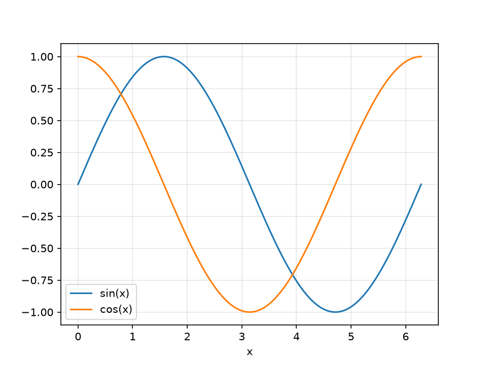
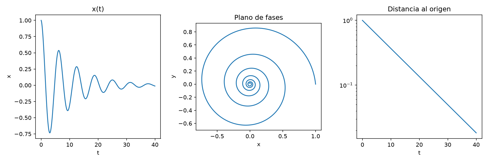

# Unidad 05 · Figuras con Python

Fortran es muy bueno calculando y no sabe dibujar. Lo que haremos durante todo el
curso es separar las dos cosas: el programa de Fortran escribe un archivo de datos y
un script de Python corto lo convierte en una figura.

Usaremos matplotlib. También existe gnuplot, que se usa mucho con Fortran y verás en
códigos antiguos, pero es bastante engorroso y su lenguaje no sirve para nada más.
Con Python, además, puedes seguir analizando los datos en el mismo script.

## La figura más sencilla

Primero genera `tabla.dat` con la unidad 04. Después:

```bash
python figura_simple.py
```

```python
import numpy as np
import matplotlib.pyplot as plt

x, seno, coseno = np.loadtxt("../04_arrays_y_archivos/tabla.dat", unpack=True)

plt.plot(x, seno, label="sin(x)")
plt.plot(x, coseno, label="cos(x)")
plt.xlabel("x")
plt.legend()

plt.savefig("tabla.png", dpi=150)
plt.show()
```

`np.loadtxt` lee las columnas y se salta las líneas que empiezan por `#`. `unpack=True`
reparte cada columna en una variable. `savefig` guarda la figura y `show` abre una
ventana para verla; el script termina cuando la cierras.



## Varios paneles

La mayoría de las figuras del curso tendrán más de un panel. `espiral.f90` escribe una
espiral con las columnas `t x y`, y `figura_paneles.py` la dibuja de tres formas:

```bash
gfortran espiral.f90 -o espiral
./espiral
python figura_paneles.py
```

```python
fig, (izquierda, centro, derecha) = plt.subplots(1, 3, figsize=(12, 4))

izquierda.plot(t, x)
centro.plot(x, y)
centro.set_aspect("equal")
derecha.semilogy(t, np.sqrt(x**2 + y**2))
```



Es la plantilla que usaremos de aquí en adelante. Con tener a mano esto ya tienes casi
todo lo que necesitas:

| Quiero... | Con un panel `ax` |
|---|---|
| Una curva | `ax.plot(x, y)` |
| Eje logarítmico en y, o en los dos | `ax.semilogy(x, y)`, `ax.loglog(x, y)` |
| Títulos de los ejes | `ax.set_xlabel("x")`, `ax.set_ylabel("y")` |
| Limitar los ejes | `ax.set_xlim(-3, 3)` |
| La misma escala en los dos ejes | `ax.set_aspect("equal")` |
| Una leyenda | `ax.plot(x, y, label="...")` y `ax.legend()` |
| Elegir el aspecto | `ax.plot(x, y, color="red", lw=2, ls="--")` |

## Ejercicios

1. Añade a `figura_simple.py` una tercera curva con `sin(x) * cos(x)`. No hace falta
   tocar el programa de Fortran: se calcula en Python.
2. Haz que `figura_paneles.py` guarde la figura también en PDF.
3. Cambia el `-t/10` de `espiral.f90` por `-t/30`, recompila y vuelve a dibujar. ¿Cómo
   cambia la pendiente del tercer panel?
