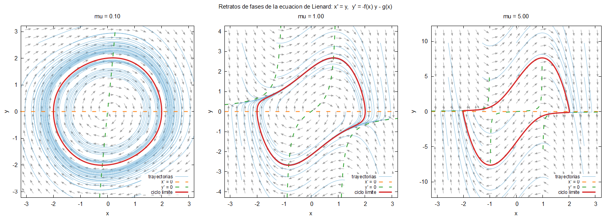

# Bloque 05 · Retratos de fases

Retratos de fases de Van der Pol para varios valores de `mu` (por defecto
0.1, 1 y 5): campo de vectores, trayectorias, ciclo límite y nulclinas,
en una figura de varios paneles. **No se escribe ningún integrador nuevo**:
se reutiliza el del bloque 04.

## Compilar y ejecutar

```bash
make run        # calcula y dibuja (resultados/retrato.png)
make plot       # solo vuelve a dibujar
make run-debug
make clean
```

Con fpm: `fpm run`. Tarda menos de un segundo.



## Qué se calcula (para cada `mu`)

| Archivo | Contenido |
|---|---|
| `ciclo_<k>.dat` | se integra desde `(2, 0)` durante `t_transitorio` y **se descarta**; después se guarda un tramo de `t_ciclo`: lo que queda es el ciclo límite |
| `campo_<k>.dat` | campo de vectores en una rejilla `n_flechas × n_flechas`, normalizado (solo importa la dirección) |
| `trayectorias_<k>.dat` | trayectorias desde una rejilla `n_condiciones × n_condiciones`, durante `t_trayectoria` |
| `nulclinas_<k>.dat` | `x' = 0` (la recta `y = 0`) e `y' = 0` (la curva `y = −g(x)/f(x)`) |

La caja del dibujo se adapta a cada `mu`: es la del ciclo límite ampliada
por `margen`. Todo se configura en `entrada.nml` (incluidos los valores de
`mu`, hasta 10, y el tablero de Butcher).

## Reutilización de módulos

```
03_euler_lienard/src/        modelo_lienard.f90, sistema.f90
04_runge_kutta_butcher/src/  algebra_lineal.f90, tablero_butcher.f90, solver_rk.f90
05_retrato_de_fases/src/     retrato_fases.f90        <- lo único nuevo
05_retrato_de_fases/app/     principal.f90
```

**Estrategia elegida: referencias relativas, sin copiar fuentes.**

- El `Makefile` compila los fuentes de los bloques 03 y 04 desde sus
  carpetas (`vpath %.f90 ../03_euler_lienard/src ../04_runge_kutta_butcher/src ...`)
  y deja los objetos y `.mod` en `build/` de este bloque.
- `fpm.toml` declara el bloque 04 como **dependencia local**
  (`rk_butcher = { path = "../04_runge_kutta_butcher" }`), que a su vez
  depende del 02. Es el mecanismo estándar de fpm: con una URL de git en
  lugar de `path`, la dependencia podría ser un repositorio de otro grupo.
- El tablero se lee directamente de `../04_runge_kutta_butcher/tableros/`.

Consecuencia: un único modelo y un único solver para los tres bloques. Si
corriges un error en el solver, se corrige en todos.

La regla para que esto funcione es la del bloque 04: **el solver no
conoce el modelo** (interfaz abstracta + puntero a procedimiento) y el
módulo `retrato_fases` tampoco conoce el método (recibe el tablero).

## Escribir datos para graficar

Separar cálculo y dibujo tiene ventajas: se puede rehacer la figura sin
recalcular, y los mismos datos sirven para gnuplot, Julia, Python o Matlab.
Convenios que sigue el curso:

- columnas de números separadas por espacios, en formato `es16.8` (o
  `es24.16` si interesan todas las cifras);
- cabecera y comentarios con `#` (los ignoran gnuplot, `numpy.loadtxt`,
  `readdlm` de Julia y `load` de Matlab);
- **una línea en blanco** separa curvas dentro de un archivo (gnuplot no
  las une), **dos líneas en blanco** separan *bloques* (`index 0`, `index 1`
  en gnuplot), como en `nulclinas_<k>.dat`.

Cuando la figura depende de los datos (número de paneles, rangos), el
programa **escribe el script de gnuplot** (`resultados/retrato.gp`) y luego
lo ejecuta. El script queda en disco para retocarlo a mano.

### Opcional: la misma figura con Julia

`graficar.jl` lee los mismos `.dat` con Plots.jl (no es necesario para el
curso):

```bash
julia -e 'using Pkg; Pkg.add("Plots")'    # una sola vez
julia graficar.jl                          # tras make run
```

## Ejercicio

Cambia `g(x) = x` por `g(x) = x**3`: el oscilador
`x'' + mu(x² − 1)x' + x³ = 0` también tiene un único ciclo límite (teorema de Liénard).

1. Edita `g` y su derivada `dg` en `../03_euler_lienard/src/modelo_lienard.f90`
   (`gx = x**3`, `dgx = 3.0_real64 * x**2`). El modelo está en un solo
   sitio y lo usan los bloques 03, 04 y 05.
2. `make run` (el Makefile detecta el cambio y recompila lo necesario).
3. Compara los ciclos con los de Van der Pol. ¿Qué pasa con la forma del
   ciclo para `mu = 0.1`? ¿Y la nulclina `y' = 0`?
4. Deja el modelo como estaba: `git checkout ../03_euler_lienard/src/modelo_lienard.f90`.
