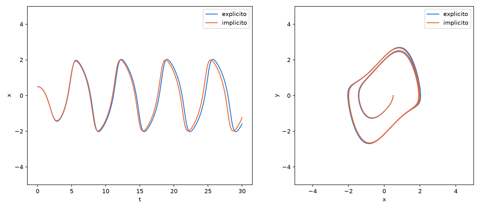
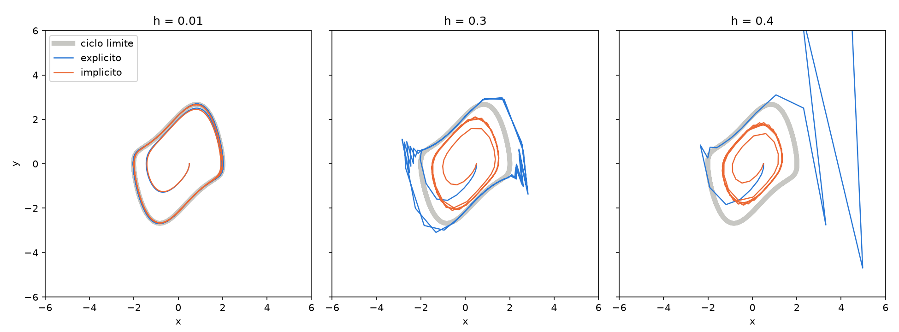

# Unidad 06 · Euler para Van der Pol

Por fin una simulación de verdad. Vamos a integrar el oscilador de Van der Pol,

```
x' = y
y' = -mu (x² - 1) y - x
```

que tiene un **ciclo límite estable**: una órbita cerrada que atrae a las de
alrededor. Lo haremos de dos formas, con dos programas muy parecidos:

| | Fórmula | Cada paso |
|---|---|---|
| **Euler explícito** | `u_{k+1} = u_k + h F(u_k)` | Una cuenta directa |
| **Euler implícito** | `u_{k+1} = u_k + h F(u_{k+1})` | Resolver un sistema no lineal con Newton |

```bash
gfortran euler_explicito.f90 -o euler_explicito
./euler_explicito
gfortran euler_implicito.f90 -o euler_implicito
./euler_implicito
python graficar.py
```



## Los dos programas principales

Ábrelos uno al lado del otro: solo cambia lo que hay dentro del bucle.

```fortran
! euler_explicito.f90
do k = 1, n_pasos
    u = u + h * campo(u)
    write(unidad, '(3es24.16)') k * h, u
end do
```

```fortran
! euler_implicito.f90
do k = 1, n_pasos
    call paso_euler_implicito(u, h, iteraciones)
    write(unidad, '(3es24.16)') k * h, u
end do
```

Lo que va después de `contains` son procedimientos internos del programa, que pueden
usar sus variables y constantes (como `mu`).

## Función o subrutina

Fortran tiene dos clases de procedimientos. Una **función** devuelve un valor y se usa
dentro de una expresión, como `campo(u)`:

```fortran
function campo(u) result(du)
    real(real64), intent(in) :: u(2)
    real(real64) :: du(2)
    du(1) = u(2)
    du(2) = -mu * (u(1)**2 - 1) * u(2) - u(1)
end function campo
```

Una **subrutina** se llama con `call` y devuelve sus resultados modificando los
argumentos. Es lo natural cuando hay más de un resultado, como aquí, donde queremos
el nuevo estado y las iteraciones de Newton que han hecho falta:

```fortran
subroutine paso_euler_implicito(u, h, iteraciones)
    real(real64), intent(inout) :: u(2)     ! entra u_k y sale u_{k+1}
    real(real64), intent(in) :: h           ! solo se lee
    integer, intent(out) :: iteraciones     ! solo se escribe
    ...
end subroutine paso_euler_implicito
```

## `intent`: qué hace cada argumento

En Fortran los argumentos se pasan por referencia, así que un procedimiento podría
modificar cualquiera de ellos. `intent` declara qué piensa hacer con cada uno, y el
compilador lo comprueba:

| | Al entrar | Dentro del procedimiento | Ejemplo |
|---|---|---|---|
| `intent(in)` | Tiene un valor | Solo se lee; modificarlo es un error de compilación | `h` |
| `intent(out)` | Se considera indefinido | Hay que darle un valor | `iteraciones` |
| `intent(inout)` | Tiene un valor | Se lee y se modifica | `u` |

Ponlo siempre: documenta el código y evita errores muy difíciles de encontrar.

## Cuando Euler explícito se rompe

Con `h = 0.01` todo va bien, pero Euler es un método de orden 1 y se resiente enseguida.
Cambia el `h` en los dos programas, recompila y vuelve a dibujar:



La órbita gris es el ciclo límite, que tiene amplitud 2 en `x`:

| `h` | Euler explícito | Euler implícito |
|---:|---|---|
| 0,01 | Amplitud 2,03: bien | Amplitud 1,99: bien |
| 0,3 | Amplitud 2,83: la órbita se hincha y zigzaguea | Amplitud 1,51: la órbita se encoge |
| 0,4 | **Explota** en `t = 9,6` | Amplitud 1,36: no explota, pero está mal |

La lección tiene dos partes. Euler explícito añade energía de forma artificial, y con
un paso algo grande deja de haber órbita estable. El implícito la quita: no explota,
pero tampoco acierta. Con `mu = 0.1` y `h = 0.2` llega a hacer desaparecer el ciclo, y
la solución cae al origen.

Ninguno de los dos es de fiar con pasos grandes, y bajar `h` sin parar sale caro. Lo
mejoraremos con **Runge–Kutta de alto orden** en la unidad 08: RK4 con `h = 0.4`
mantiene el ciclo con amplitud 2,00, justo donde Euler explícito explota.

## Lo que todavía falla

- Para cambiar `mu` o `h` hay que recompilar.
- El modelo, el método y la salida están mezclados en un archivo.
- Euler es de orden 1.

De todo esto nos ocupamos en la segunda sesión.

## Ejercicios

1. Pon `mu = 5` y `t_final = 50`: son oscilaciones de relajación. ¿Qué `h` necesita
   cada método para no romperse?
2. Escribe una subrutina `paso_euler_explicito(u, h)` con los `intent` correctos y
   úsala con `call` en el bucle.
3. Intenta modificar `h` dentro de `paso_euler_implicito`. ¿Qué dice el compilador?
4. Imprime el máximo de iteraciones de Newton de toda la simulación. ¿Depende de `h`?

Tienes más ejercicios en la [lista para hacer entre sesiones](../EJERCICIOS.md).
