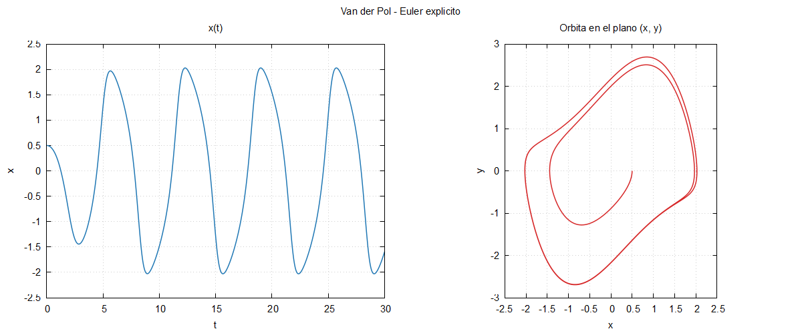

# Bloque 06 · Módulos, archivo de entrada y make

**El mismo Euler del bloque 05**, organizado como un código de
investigación: el modelo, el método y el programa principal en archivos
distintos; los parámetros en un archivo de entrada (sin recompilar); y un
`Makefile` que compila en modo optimizado o en modo de depuración.

El resultado es **bit a bit idéntico** al del bloque 05 cuando ambos se
compilan con las mismas opciones (`-O3 -march=native` o `-O0`).

## Compilar y ejecutar

```bash
make run          # compila (release), ejecuta con entrada.nml y dibuja
make run-debug    # lo mismo, en modo debug
make plot         # solo dibuja
make clean
```

En PowerShell, `mingw32-make run`. En VS Code, **Ctrl+Shift+B** con
cualquier archivo del bloque abierto. Con otro archivo de entrada:
`./euler otro.nml`. Con fpm: `fpm run` (o `fpm run -- otro.nml`).

Salida: `resultados/euler.dat` (columnas `t x y`) y `resultados/euler.png`.



## Archivos

```
06_modulos_y_make/
├── src/modelo.f90         módulo modelo: f, g y el campo F(u)
├── src/metodo_euler.f90   módulo metodo_euler: integrar_euler
├── app/principal.f90      programa: lee la entrada, integra y escribe
├── entrada.nml            parámetros
├── graficar.gp            gnuplot: x(t) y órbita
├── Makefile
├── fpm.toml
└── error_indice.f90       demostración de -fcheck=all
```

## 1. Módulos

```fortran
module modelo
    use, intrinsic :: iso_fortran_env, only: real64
    implicit none
    private                 ! todo es privado...
    public :: campo         ! ...salvo lo que se exporta

contains

    pure function campo(u, mu) result(du)
        ...
end module modelo
```

y quien lo necesita:

```fortran
use modelo, only: campo
```

- Un **módulo** agrupa procedimientos (y tipos y constantes). `private` +
  `public` decide qué se ve desde fuera: `f` y `g` son detalles internos
  del modelo; solo se exporta `campo`.
- `use modulo, only: nombre` importa solo lo que se nombra: se sabe de
  dónde viene cada cosa.
- `pure`: la función no tiene efectos secundarios (no escribe, no modifica
  nada externo). Lo comprueba el compilador y le permite optimizar más.

Al compilar un módulo, gfortran genera un archivo **`.mod`** (su interfaz
compilada). Consecuencia: **un módulo debe compilarse antes que quien lo usa**.

| | Fortran | C++ | Julia |
|---|---|---|---|
| Interfaz | `.mod`, generado por el compilador | `.h`, escrito a mano | no hay |
| Importar | `use modelo, only: campo` | `#include "modelo.h"` | `using .Modelo: campo` |
| Visibilidad | `private` / `public` | `static`, `namespace` | `export` |

## 2. `namelist`: un archivo de entrada sin escribir un lector

```fortran
namelist /parametros/ mu, h, t_final, x0, y0, archivo_salida
read(unidad, nml=parametros)
```

lee `entrada.nml`:

```fortran
&parametros
    mu      = 1.0        ! parámetro de Van der Pol
    h       = 0.01
    ...
/
```

El orden no importa, admite comentarios con `!` y lo que no aparece
conserva su valor por defecto. Si hay un error (una variable que no
existe, un valor mal escrito), el programa se detiene y dice en qué línea.

**Línea de órdenes**: `get_command_argument(1, archivo_entrada)` lee el
primer argumento. Así se lanzan varios experimentos con el mismo
ejecutable: `./euler mu5.nml`.

## 3. Compilación separada y `make`

Compilar un proyecto con módulos son dos pasos:

```bash
gfortran -c src/modelo.f90           # -> modelo.o y modelo.mod
gfortran -c src/metodo_euler.f90     # necesita modelo.mod
gfortran -c app/principal.f90        # necesita metodo_euler.mod
gfortran modelo.o metodo_euler.o principal.o -o euler     # enlazar
```

El `Makefile` lo automatiza y solo recompila lo que ha cambiado. Lo
esencial son tres reglas:

```make
$(EJECUTABLE): $(OBJETOS)                # enlazar
	$(FC) $(FFLAGS) $^ -o $@

$(BUILD)/%.o: %.f90 | $(BUILD)           # compilar cada archivo
	$(FC) $(FFLAGS) -J$(BUILD) -c $< -o $@

$(BUILD)/metodo_euler.o: $(BUILD)/modelo.o       # quién usa a quién
$(BUILD)/principal.o: $(BUILD)/metodo_euler.o
```

El resto del `Makefile` es portabilidad (`.exe`, `cmd.exe` frente a `sh`).
[fpm](https://fpm.fortran-lang.org) hace lo mismo sin `Makefile`: averigua
solo el orden a partir de los `use`.

## 4. Release frente a debug

| | Opciones | Para qué |
|---|---|---|
| `make` | `-O3 -march=native` | producción: rápido, sin red |
| `make debug` | `-g -O0 -fcheck=all -fbacktrace -Wall -Wextra -std=f2018 -ffpe-trap=invalid,zero,overflow` | desarrollo: lento, detecta errores |

- `-fcheck=all`: índices fuera de rango, etc. `-fbacktrace`: archivo y línea del fallo.
- `-ffpe-trap=invalid,zero,overflow`: se detiene en el primer `NaN`,
  división por cero o desbordamiento, en vez de seguir calculando basura.
- `-Wall -Wextra`: avisos; `-std=f2018`: avisa de lo que no es estándar.

**Regla práctica**: desarrolla en debug; pasa a release cuando funcione.

```bash
make demo-error
```

compila `error_indice.f90`, que recorre una matriz `m(5,2)` hasta la fila 6:

```
===== release: sin comprobaciones =====
Suma de la primera columna = 115.0          <-- falso, y sin avisar
===== debug: -fcheck=all =====
At line 26 of file error_indice.f90
Fortran runtime error: Index '6' of dimension 1 of array 'm' above upper bound of 5
```

En release, `m(6,1)` lee en realidad `m(1,2) = 100`: la matriz se guarda
por columnas y el elemento siguiente a `m(5,1)` es `m(1,2)`.

## Ejercicios

1. Crea `mu5.nml` con `mu = 5`, `t_final = 50` y
   `archivo_salida = 'resultados/euler_mu5.dat'`. Ejecuta `./euler mu5.nml`
   y dibuja con `gnuplot -e "archivo='resultados/euler_mu5.dat'" graficar.gp`.
2. Escribe mal una variable en `entrada.nml` (por ejemplo, `muu = 1.0`) y
   ejecuta. Lee el mensaje de error.
3. Haz pública la función `f` del módulo `modelo` e imprime `f(2.0_real64, mu)`
   desde el programa principal. ¿Qué pasa si no la haces pública?
4. Cambia un mensaje de `app/principal.f90` y ejecuta `make`: solo se
   recompila ese archivo. Cambia después `g(x) = x + x**3` en
   `src/modelo.f90`: se recompila todo, porque los otros dos dependen de él.
