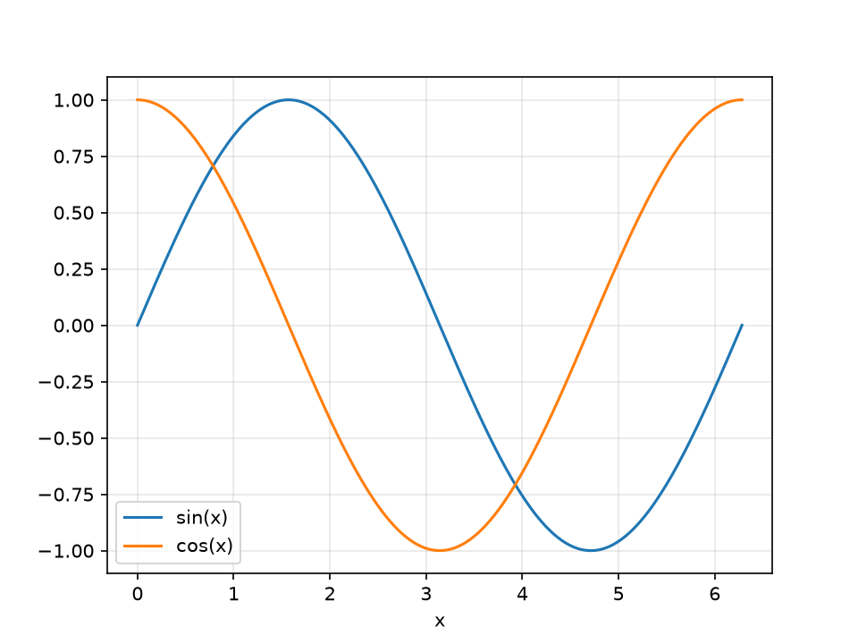
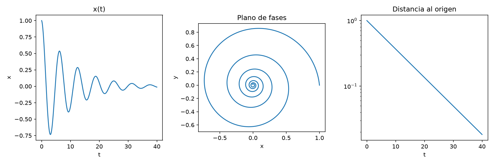
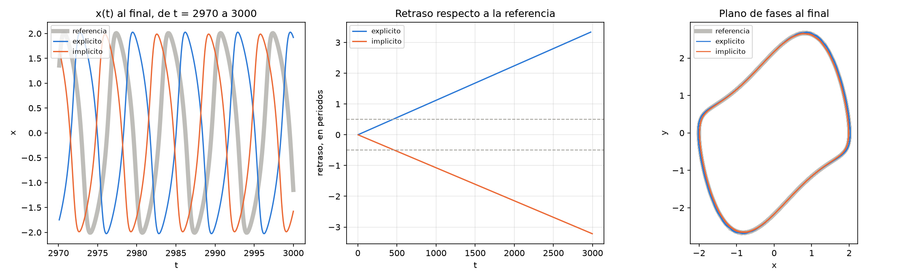
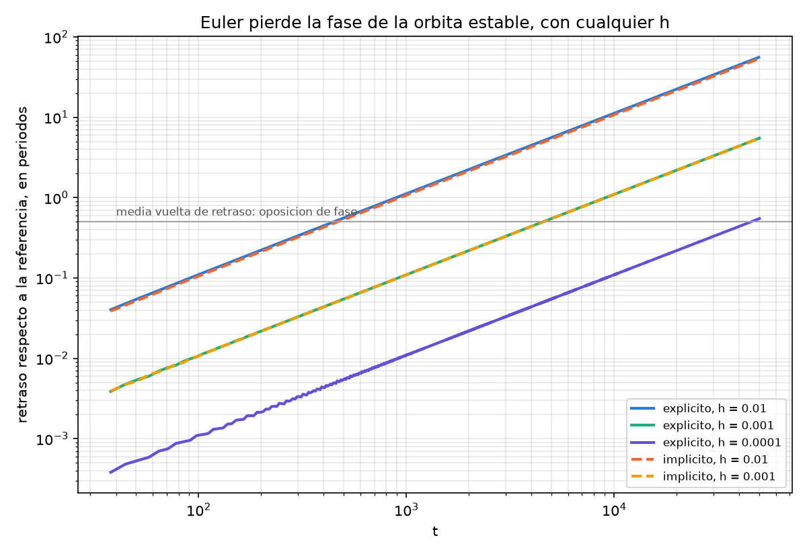
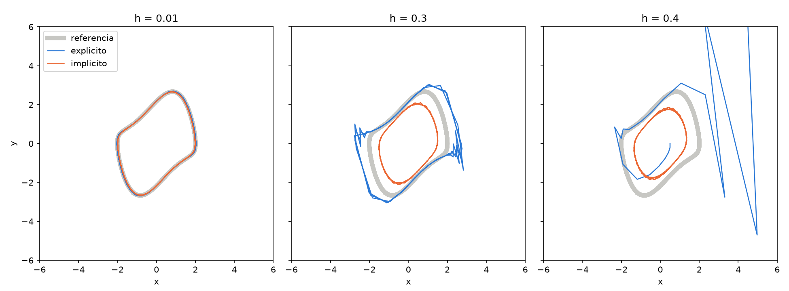

# Unidad 06 · Visualización

Fortran calcula y no dibuja. El programa escribe un archivo de datos y un script de Python lo
convierte en figura, con matplotlib. (gnuplot también se usa con Fortran, pero su lenguaje solo sirve
para eso; con Python se puede además analizar los datos en el mismo script.)

Hacen falta `numpy` y `matplotlib`:

```bash
pip install numpy
pip install matplotlib
```

## Figuras sencillas

Con `./tabla` ejecutado en la unidad 04:

```bash
python figura_simple.py
```

```python
x, seno, coseno = np.loadtxt("../04_arrays_y_archivos/tabla.dat", unpack=True)

plt.plot(x, seno, label="sin(x)")
plt.plot(x, coseno, label="cos(x)")
plt.xlabel("x")
plt.legend()
plt.savefig("tabla.png", dpi=150)
plt.show()
```

`np.loadtxt` omite las líneas que empiezan por `#`, y `unpack=True` asigna cada columna a una
variable. `show` abre una ventana y el programa termina al cerrarla.



`espiral.f90` escribe una espiral, y `figura_paneles.py` la dibuja en tres paneles con
`plt.subplots(1, 3)`, usando `ax.plot`, `ax.semilogy` (eje y logarítmico) y `ax.set_aspect("equal")`
(misma escala en los dos ejes):

```bash
gfortran espiral.f90 -o espiral
./espiral
python figura_paneles.py
```



## Los dos Euler

Con `euler_explicito`, `euler_implicito` y `referencia` ya ejecutados en la unidad 05:

```bash
python euler.py
```

```
             periodo  amplitud  t con |error| > 0.5
referencia    6.6632    2.0086                    -
 explicito    6.7130    2.0278                   21
 implicito    6.6155    1.9897                   24
```



En el plano de fases (derecha) las dos soluciones de Euler están sobre una curva cerrada muy próxima
a la de referencia: la amplitud del explícito es un 1 % mayor, y la del implícito, un 1 % menor. Pero
`x(t)` (izquierda) está desfasada. Euler explícito tiene periodo 6,713 frente a 6,663, y el implícito,
6,616. La diferencia se acumula en cada periodo, y el panel central la dibuja como retraso respecto a
la referencia, en periodos:

- A `t = 3000`, el explícito va 3,34 periodos por detrás y el implícito, 3,22 por delante.
- Con medio periodo de retraso, la solución está en oposición de fase con la referencia. El explícito
  llega a ese punto en `t ≈ 450` y el implícito, en `t ≈ 470`.
- El retraso crece linealmente con `t`: el error de periodo es proporcional a `h`, y se suma periodo
  a periodo.

## Reducir h solo retrasa el problema

Con `h = 0.001` y `h = 0.0001` (cambiando `h` en el código y recompilando) el retraso sigue siendo una
recta, en escala logarítmica, y la línea gris marca el medio periodo:



| `h` | pasos hasta `t = 3000` | `t` con medio periodo de retraso (explícito) | (implícito) |
|---:|---:|---:|---:|
| 0,01 | 3·10⁵ | 451 | 471 |
| 0,001 | 3·10⁶ | 4549 | 4569 |
| 0,0001 | 3·10⁷ | 45 548 | no medido |

Dividir `h` entre diez multiplica por diez el tiempo hasta perder la fase. Para llegar a `t = 3000` con
un retraso de 0,01 periodos haría falta `h ≈ 3·10⁻⁵`, unos 10⁸ pasos (extrapolando la proporcionalidad
medida). El implícito no mejora: su retraso es igual y de signo contrario. Para el ciclo límite de Van
der Pol, Euler no es adecuado en tiempos largos, con ninguna de sus variantes y con ningún paso. RK4,
en la unidad 09, consigue con `h = 0.01` un retraso inferior a 0,001 periodos.

## Pasos grandes

Con `h` grande las órbitas son muy distintas de la de referencia:



| `h` | Euler explícito | Euler implícito |
|---:|---|---|
| 0,01 | amplitud 2,03 | amplitud 1,99 |
| 0,3 | amplitud 2,86, con zigzags | amplitud 1,51 |
| 0,4 | explota en `t = 9,6` | amplitud 1,36 |

La amplitud es el máximo de `|x|` a partir de `t = 15`, y la del ciclo real es 2,01. Con `mu = 0.1` y
`h = 0.2`, Euler implícito hace desaparecer el ciclo. RK4 con `h = 0.4` mantiene el ciclo con
amplitud 2,00 (unidad 09).

## Ejercicios

1. Añade a `figura_simple.py` la curva `sin(x) * cos(x)`, calculada en Python.
2. Haz que `figura_paneles.py` guarde también un PDF.
3. En `espiral.f90`, cambia `-t/10` por `-t/30`, recompila y describe el cambio en el tercer panel.
4. Calcula el retraso para `h = 0.001` con `euler.py`: cambia `h` en los dos programas de la unidad 05,
   recompila, ejecuta y comprueba que el retraso final es diez veces menor.
