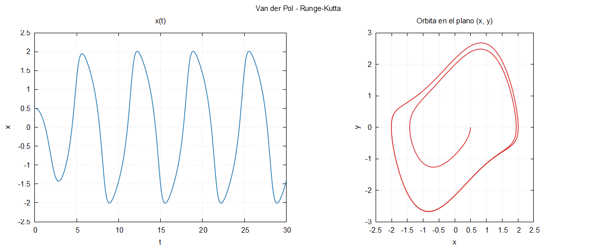
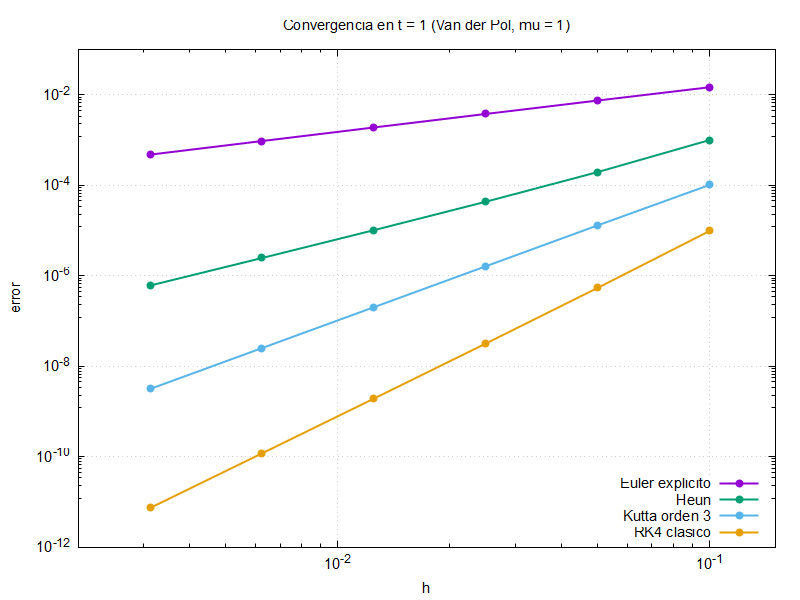

# Bloque 07 · Runge–Kutta con tableros de Butcher

Sustituimos Euler por **cualquier Runge–Kutta explícito**, definido por
su tablero de Butcher y leído de un archivo. Para cambiar de método basta
con cambiar de archivo; el código no se toca. Lo nuevo en Fortran: los
**tipos derivados**. Y lo nuevo en numérica: comprobar el **orden de
convergencia**.

```
c | A           k_i     = F(u_n + h Σ_{j<i} a_ij k_j),   i = 1..s
--+----         u_{n+1} = u_n + h Σ_i b_i k_i
  | bᵀ
```

## Compilar y ejecutar

```bash
make run                                   # RK4 con entrada.nml, y figura
./rk entrada.nml tableros/heun.txt         # otro tablero (2.º argumento)
make convergencia                          # orden observado de todos los tableros
make clean
```

Con Euler explícito (`tableros/euler_explicito.txt`), el resultado es
**bit a bit idéntico** al de los bloques 05 y 06 (con las mismas opciones
de compilación): el código general reproduce el caso particular.



## Archivos

```
07_runge_kutta/
├── src/modelo.f90            el mismo del bloque 06 (copia exacta)
├── src/tablero_butcher.f90   tipo tablero y su lectura
├── src/runge_kutta.f90       paso_rk e integrar_rk
├── app/principal.f90         programa rk
├── app/convergencia.f90      programa convergencia
├── tableros/                 euler_explicito, heun, kutta3, rk4
└── entrada.nml, graficar.gp, graficar_convergencia.gp, Makefile, fpm.toml
```

## Los tableros, también en `namelist`

```fortran
! Runge-Kutta clásico de orden 4 (Kutta, 1901).
&etapas  s = 4  /
&coeficientes
    nombre = 'RK4 clasico'
    orden  = 4
    a(2,:) = 0.5, 0.0, 0.0, 0.0
    a(3,:) = 0.0, 0.5, 0.0, 0.0
    a(4,:) = 0.0, 0.0, 1.0, 0.0
    b = 0.16666666666666666, 0.33333333333333333, 0.33333333333333333, 0.16666666666666666
    c = 0.0, 0.5, 0.5, 1.0
/
```

Se lee en dos pasos: primero `s`, para reservar `A`, `b` y `c` con el
tamaño justo, y después los coeficientes. `a(2,:) = ...` asigna la fila 2;
lo que no aparece vale 0 (el programa lo inicializa antes de leer).

## Tipos derivados

```fortran
type :: tablero
    character(len=:), allocatable :: nombre
    integer :: s = 0
    integer :: orden = 0
    real(real64), allocatable :: a(:, :)
    real(real64), allocatable :: b(:)
    real(real64), allocatable :: c(:)
end type tablero

type(tablero) :: tab
call leer_tablero('tableros/rk4.txt', tab)
print *, tab%nombre, tab%s           ! el % accede a las componentes
```

Como un `struct` de C++ o de Julia. Las componentes `allocatable` se
liberan solas (no hay `delete` ni fugas de memoria), y
`character(len=:), allocatable` es una cadena de longitud variable.

## El paso de Runge–Kutta, en cuatro líneas

```fortran
do i = 1, tab%s
    k(:, i) = campo(u + h * matmul(k(:, 1:i-1), tab%a(i, 1:i-1)), mu)
end do
u_nuevo = u + h * matmul(k, tab%b)
```

Cada etapa es una columna de `k(2, s)`. `matmul(k(:, 1:i-1), a(i, 1:i-1))`
es `Σ_{j<i} a_ij k_j`; para `i = 1` el corte está vacío y la suma vale 0.
Es la fórmula del método, casi literal.

`integrar_rk` comprueba antes que el tablero es explícito (`A`
estrictamente triangular inferior). Los implícitos, en el bloque 09.

## Convergencia

`make convergencia` integra Van der Pol (`mu = 1`) hasta `t = 1` con
`h = 0.1, 0.05, …, 0.1/32`, mide el error frente a una referencia (RK4 con
`h = 10⁻⁴`) y estima el orden como `log₂(error(h) / error(h/2))` con los
dos pasos más finos:

```
                   metodo   orden teorico   orden observado
          Euler explicito         1              1.00   OK
                     Heun         2              2.02   OK
            Kutta orden 3         3              3.00   OK
              RK4 clasico         4              4.02   OK
```

Si algún orden se desvía más de 0,3 del teórico, el programa termina con
`stop 1` (código de error 1): así lo usa la integración continua.



## Ejercicios

1. Escribe `tableros/ralston.txt`, el método de orden 2 de Ralston:
   `a21 = 2/3`, `b = (1/4, 3/4)`, `c = (0, 2/3)`. Pasa el test de convergencia.
2. Escribe mal un coeficiente de RK4 (por ejemplo, `b(1) = 0.17`) y pasa
   el test: ¿qué orden sale?
3. Con `entrada.nml`, compara Euler, Heun y RK4 con `h = 0.1`. ¿Cuál
   mantiene la órbita cerrada?
4. Añade una componente `logical :: explicito` al tipo `tablero` y
   rellénala al leerlo, para no tener que llamar a `es_explicito` en cada integración.
