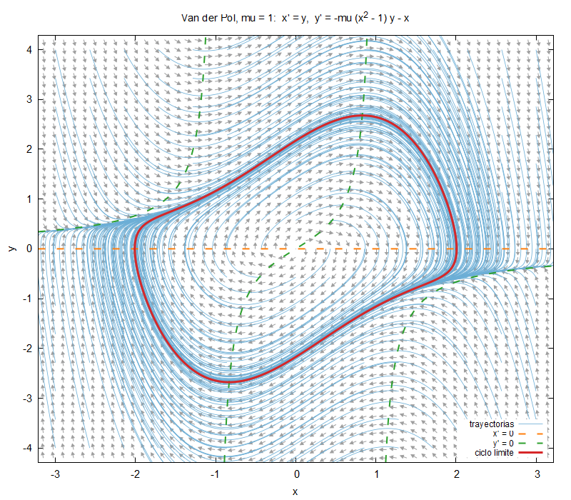
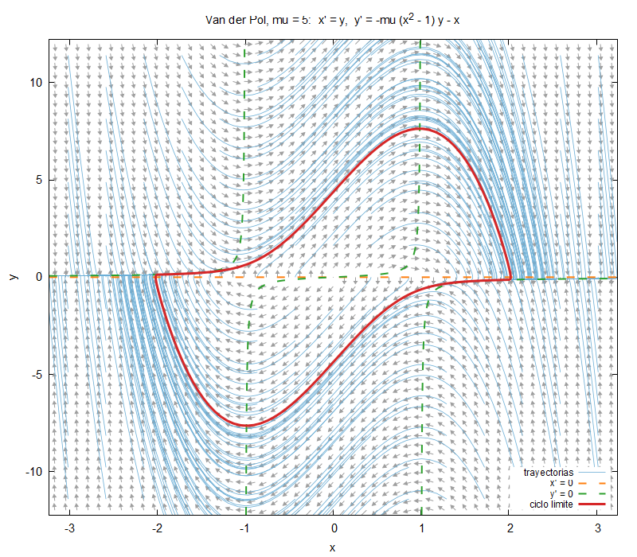

# Bloque 08 · Retrato de fases

Con el integrador del bloque 07 ya podemos estudiar la dinámica: el
**retrato de fases** de Van der Pol, con el campo de direcciones, muchas
trayectorias, las nulclinas y el ciclo límite. **No hay ningún integrador
nuevo**: los módulos de `src/` son copias exactas de los del bloque 07
(la integración continua comprueba que no se separen) y el tablero se lee
de `../07_runge_kutta/tableros/`.

```bash
make run                 # calcula y dibuja (resultados/retrato.png), ~1 s
./retrato mu5.nml        # con otro archivo de entrada
make plot                # solo dibuja
```

| `mu = 1` | `mu = 5` |
|---|---|
|  |  |

## Qué calcula

| Archivo | Contenido |
|---|---|
| `ciclo.dat` | se integra desde `(2, 0)` durante `t_transitorio` y **se descarta**; el tramo siguiente, de duración `t_ciclo`, es el ciclo límite |
| `campo.dat` | flechas `x y dx dy` en una rejilla `n_flechas × n_flechas`, todas de la misma longitud |
| `trayectorias.dat` | trayectorias desde una rejilla `n_condiciones × n_condiciones`, separadas por líneas en blanco |
| `parametros.gp` | `mu` y el tamaño de la caja, que lee `graficar.gp` |

La caja del dibujo se adapta a `mu`: es la del ciclo ampliada por `margen`.
Las nulclinas (`x' = 0`: la recta `y = 0`; `y' = 0`: la curva
`y = −x / (mu (x² − 1))`) las dibuja directamente gnuplot.

## Lo nuevo en Fortran

**Cortes con paso para escribir menos datos.** Con `h = 0.001`, cada
trayectoria tiene 10 000 pasos; se escribe uno de cada `paso_escritura`:

```fortran
write(unidad, '(2es16.8)') u(:, ::paso_escritura)
```

`u(:, ::10)` son las columnas 0, 10, 20... Como el formato tiene sitio
para dos números, Fortran **reutiliza el formato** y escribe una columna
(un estado `x y`) por línea, sin bucle.

**Funciones intrínsecas sobre arrays** para la caja:

```fortran
x_max = margen * maxval(abs(u(1, :)))
```

**Un argumento no puede estar a la vez en dos sitios.** Para seguir
integrando desde el final del transitorio:

```fortran
call integrar_rk(tab, [2.0_real64, 0.0_real64], mu, h, n, u)
u_inicio = u(:, ubound(u, 2))                 ! copia
call integrar_rk(tab, u_inicio, mu, h, n, u)  ! bien
! call integrar_rk(tab, u(:, ubound(u, 2)), mu, h, n, u)   ! MAL
```

La línea comentada pasa `u` dos veces: como estado inicial y como
resultado (`intent(out)`, que se vuelve a reservar al entrar). El estándar
prohíbe este **solapamiento de argumentos** (*aliasing*); a cambio, el
compilador puede suponer que los argumentos no se solapan y optimizar más
(véase el bloque 00). No siempre da error: puede funcionar en un sistema
y fallar en otro.

## Ejercicios

1. Crea `mu5.nml` con `mu = 5` y compara con `mu = 1`: oscilaciones de
   relajación, con tramos lentos sobre la nulclina y saltos rápidos.
2. Con `mu = 0.1` el ciclo es casi una circunferencia de radio 2. Mide su
   amplitud con `maxval(u(1, :))` e imprímela.
3. El ciclo es atractor: cambia en el programa el punto de partida del
   transitorio, `(2, 0)`, por `(0.01, 0)`. ¿Se llega al mismo ciclo?
4. Usa `tablero_archivo = '../07_runge_kutta/tableros/euler_explicito.txt'`
   con `h = 0.05`. ¿Sigue habiendo ciclo límite?
