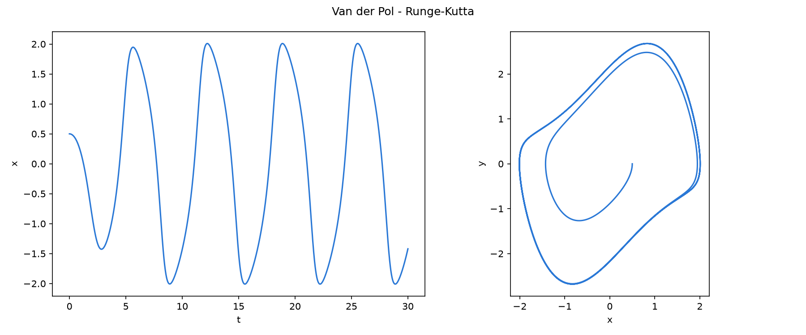
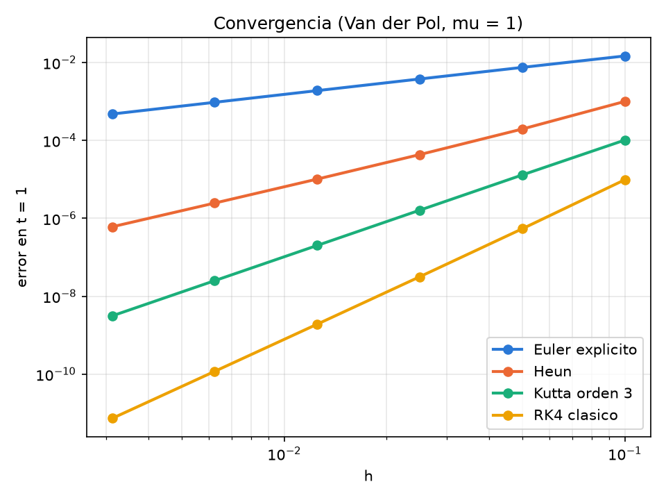

# Unidad 08 · Runge–Kutta con tableros de Butcher

Ahora sustituimos Euler por **cualquier** Runge–Kutta explícito. Un método así es solo
una tabla de números, así que la leemos de un archivo: para cambiar de método, se cambia
de archivo, sin tocar el código.

```
c | A           k_i     = F(u_n + h Σ_{j<i} a_ij k_j)
--+----         u_{n+1} = u_n + h Σ_i b_i k_i
  | bᵀ
```

```bash
make run                                # RK4, con figura
./rk entrada.nml tableros/heun.txt      # otro método
make convergencia                       # comprueba el orden de todos
```



## Tipos derivados

Agrupan varios datos, como un `struct` de C++ o de Julia:

```fortran
type :: tablero
    character(len=:), allocatable :: nombre
    integer :: s = 0
    integer :: orden = 0
    real(real64), allocatable :: a(:, :)
    real(real64), allocatable :: b(:)
    real(real64), allocatable :: c(:)
end type tablero

type(tablero) :: tab
call leer_tablero('tableros/rk4.txt', tab)
print *, tab%nombre, tab%s      ! el % accede a las componentes
```

Las componentes `allocatable` también se liberan solas.

## El paso de Runge–Kutta

Son cuatro líneas, y siguen la fórmula casi al pie de la letra:

```fortran
do i = 1, tab%s
    k(:, i) = campo(u + h * matmul(k(:, 1:i-1), tab%a(i, 1:i-1)), mu)
end do
u_nuevo = u + h * matmul(k, tab%b)
```

Cada etapa es una columna de `k`. Para `i = 1`, el corte está vacío y la suma vale cero,
sin casos especiales.

## ¿Cómo sé que está bien?

Midiendo el orden. Si un método es de orden `p`, al dividir `h` entre dos el error se
divide por `2^p`. `make convergencia` hace justo eso:

```
                   metodo   orden teorico   orden observado
          Euler explicito         1              1.00   OK
                     Heun         2              2.02   OK
            Kutta orden 3         3              3.00   OK
              RK4 clasico         4              4.02   OK
```



Es la forma más barata de descubrir un coeficiente mal escrito. Si un orden se desvía,
el programa lo marca con `FALLA` y termina con un código de error.

## ¿Y lo de Euler?

¿Recuerdas que Euler explícito explotaba con `h = 0.4`? Prueba a poner ese paso en
`entrada.nml`. RK4 mantiene el ciclo límite, con amplitud 2,00.

## Ejercicios

1. Escribe `tableros/ralston.txt`, el método de Ralston de orden 2: `a21 = 2/3`,
   `b = (1/4, 3/4)`, `c = (0, 2/3)`. ¿Pasa el test de convergencia?
2. Escribe mal un coeficiente de RK4, por ejemplo `b(1) = 0.17`. ¿Qué orden sale?
3. Compara Euler, Heun y RK4 con `h = 0.1` y dibuja las órbitas.
