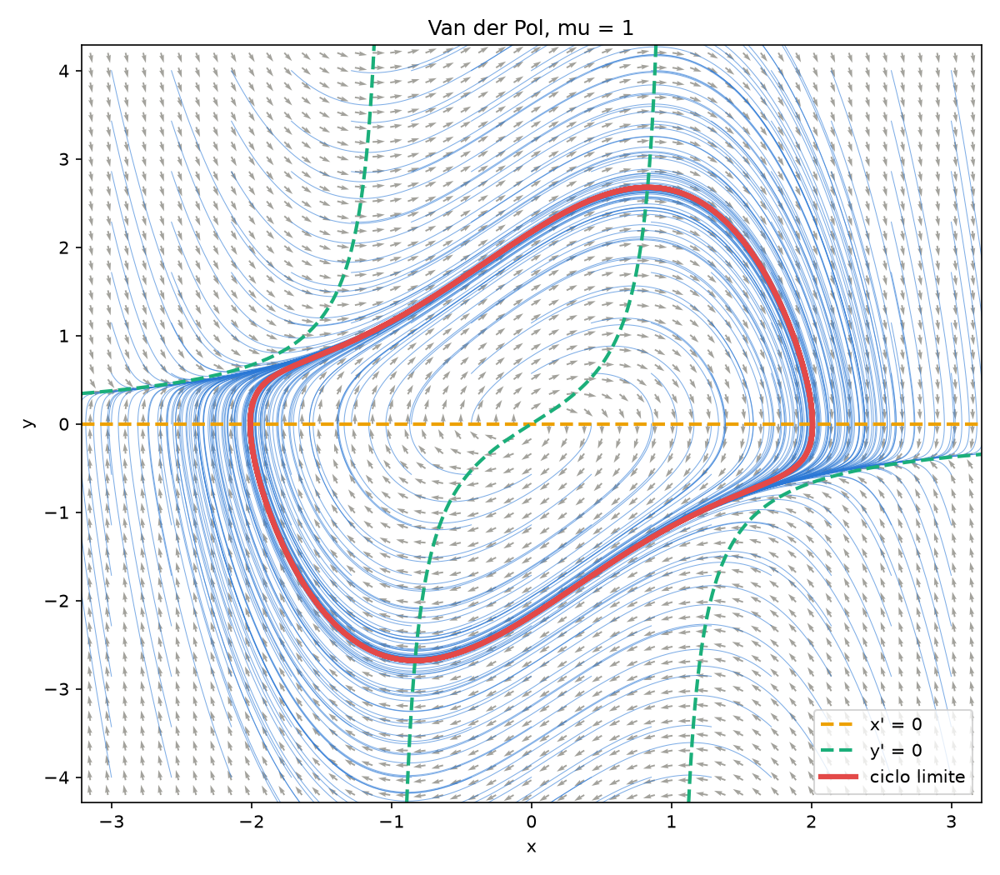
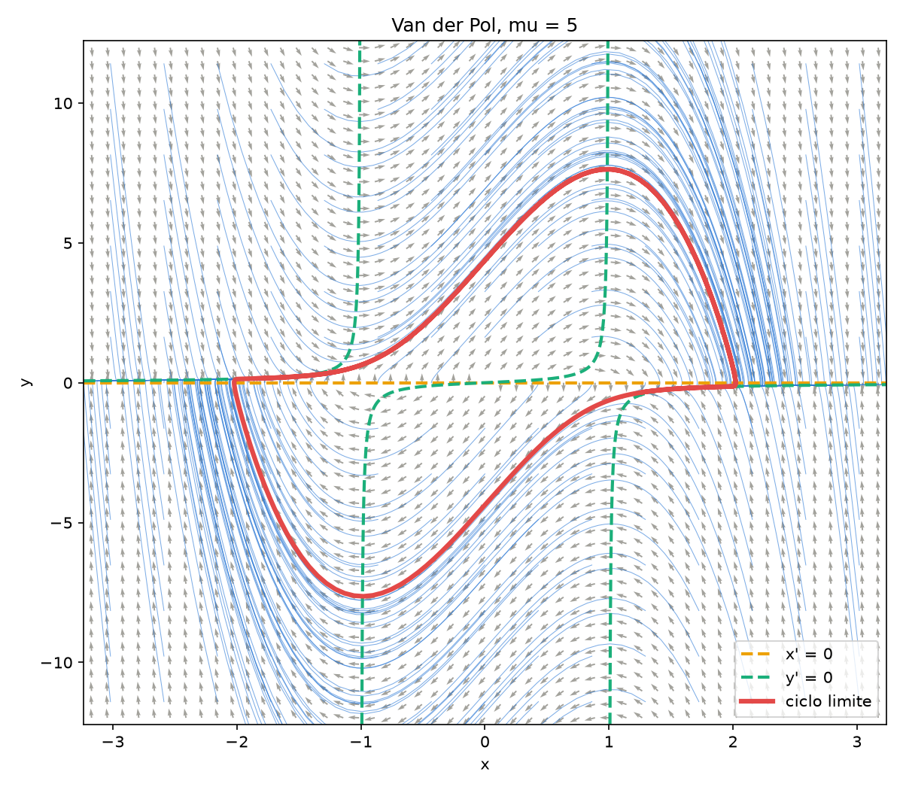

# Unidad 09 · Retrato de fases

Ya tenemos un integrador en el que confiar, así que vamos a usarlo. En esta unidad no
hay ningún método nuevo: los módulos de `src/` son los de la unidad 08 sin cambios, y
solo escribimos un programa principal que dibuja el retrato de fases.

```bash
make run        # tarda alrededor de un segundo
```

| `mu = 1` | `mu = 5` |
|---|---|
|  |  |

En gris está el campo de direcciones; en azul, las trayectorias; en discontinua, las
nulclinas; y en rojo, el ciclo límite. Todas las trayectorias acaban en él.

## Lo nuevo en Fortran

**Escribir menos datos.** Con `h = 0.001`, cada trayectoria tiene 10 000 pasos. Podemos
escribir uno de cada diez con un corte con paso, y sin bucle:

```fortran
write(unidad, '(2es16.8)') u(:, ::paso_escritura)
```

Como el formato tiene sitio para dos números, Fortran lo reutiliza y escribe un estado
por línea.

**Un argumento no puede estar en dos sitios a la vez.** Para seguir integrando desde el
final de un tramo, hay que hacer una copia:

```fortran
u_inicio = u(:, ubound(u, 2))                 ! copia
call integrar_rk(tab, u_inicio, mu, h, n, u)  ! bien
! call integrar_rk(tab, u(:, ubound(u, 2)), mu, h, n, u)   ! MAL
```

La línea comentada pasa `u` a la vez como dato y como resultado. El estándar lo prohíbe,
y no siempre da error: puede funcionar en tu ordenador y fallar en el de otra persona.

## Ejercicios

1. Crea `mu5.nml` con `mu = 5` y ejecuta `./retrato mu5.nml`. Observa los tramos lentos
   sobre la nulclina y los saltos rápidos.
2. Con `mu = 0.1` el ciclo es casi una circunferencia de radio 2. Mide su amplitud con
   `maxval(u(1, :))`.
3. Empieza el transitorio en `(0.01, 0)` en vez de en `(2, 0)`. ¿Llegas al mismo ciclo?
4. Usa `tablero_archivo = '../08_runge_kutta/tableros/euler_explicito.txt'` con `h = 0.05`.
   ¿Sigue pareciendo correcto el retrato?
