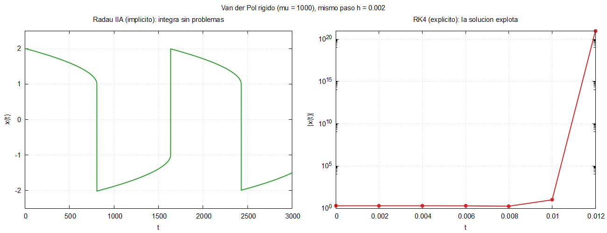
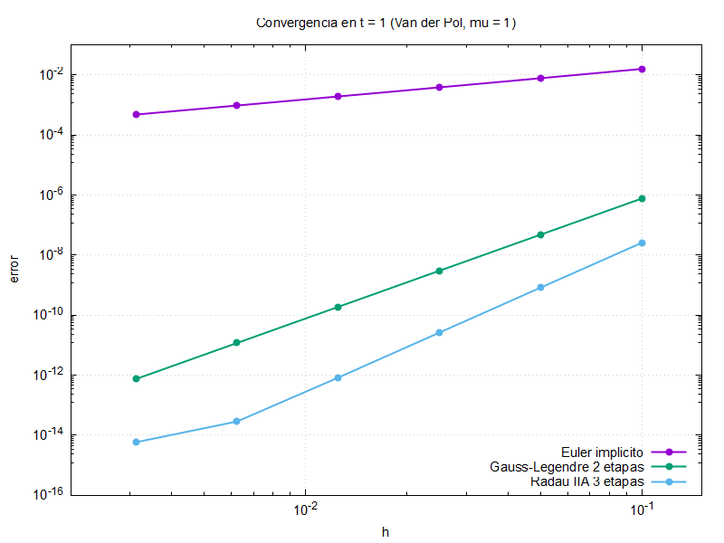

# Bloque 09 · Rigidez y Runge–Kutta implícitos

El final del curso: un problema en el que el código del bloque 07 **no
sirve**. Van der Pol con `mu = 1000` es **rígido**: RK4 explota con
cualquier paso razonable. Lo resolvemos con Runge–Kutta **implícitos**
(Radau IIA, Gauss–Legendre), que exigen resolver un sistema no lineal en
cada paso con el **método de Newton**.

Es el bloque más avanzado; en clase se puede ver como demostración
(`make run`) y leer el código con calma después.

```bash
make run             # Radau IIA y RK4 con mu = 1000 y el mismo h; figura
make convergencia    # orden observado de los tableros implícitos
```

## La demostración

`entrada.nml`: `mu = 1000`, `h = 0.002`, `t_final = 3000` (casi dos periodos).

```
Metodo: Radau IIA 3 etapas   mu = 1000.0   h =  2.00E-03   pasos = 1500000
Pasos completados: 1500000   tiempo:  1.15 s
Metodo: RK4 clasico   mu = 1000.0   h =  2.00E-03   pasos = 1500000
La solucion ha explotado (Inf o NaN) en t =  1.400E-02.
Pasos completados: 6   tiempo:  0.00 s
```

(Tiempos de un Intel Core i7-14700.)



**Por qué.** Cerca de `x = 2` el jacobiano tiene un autovalor
`≈ −mu (x² − 1) ≈ −3000`. La región de estabilidad de RK4 corta el eje
real en `≈ −2,79`, así que necesitaría `h ≲ 9·10⁻⁴`, aunque la solución
varíe lentamente. Radau IIA es **L-estable**: no tiene esa restricción y
el paso lo decide solo la precisión.

En modo debug (`make debug`), `-ffpe-trap=overflow` detiene RK4 en el
primer desbordamiento (`SIGFPE`) con una traza: justo lo que se quiere al
depurar.

## Qué cambia respecto al bloque 07

```
09_rigidez/
├── src/modelo.f90           + el jacobiano analítico
├── src/tablero_butcher.f90  igual que en el bloque 07
├── src/algebra_lineal.f90   nuevo: eliminación gaussiana con pivoteo
├── src/runge_kutta.f90      + paso_implicito (Newton) y detección de explosión
├── app/principal.f90        + cronómetro y escritura de uno de cada N pasos
├── app/convergencia.f90     igual que en el bloque 07
└── tableros/                euler_implicito, gauss_legendre2, radau_iia3, rk4
```

`integrar_rk` mantiene la misma interfaz: el programa de convergencia (`orden`) es
**el mismo archivo** que en el bloque 07 y ahora también acepta tableros
implícitos.

## El paso implícito

Las incógnitas son `z_i = h Σ_j a_ij F(u + z_j)`, `i = 1..s`: un sistema
no lineal de dimensión `2s`. Newton:

```fortran
do iter = 1, max_iter_newton
    do j = 1, tab%s
        fz(:, j) = campo(u + z(:, j), mu)
    end do
    g = z - h * matmul(fz, transpose(tab%a))         ! residuo G(z)

    ! Matriz de Newton por bloques 2x2:  delta_ij I - h a_ij J(u + z_j)
    ...
    call resolver_sistema(m, reshape(-g, [2*tab%s]), dz, singular)
    z = z + reshape(dz, [2, tab%s])
    if (maxval(abs(dz)) <= tol_newton * (1 + maxval(abs(u)))) exit
end do
```

- **`reshape`** ve la matriz `g(2, s)` como un vector de `2s` componentes,
  columna tras columna (el orden de la memoria), y al revés.
- **`resolver_sistema`** es una eliminación gaussiana escrita a mano para
  ver cómo se recorren matrices por columnas. En un código real se usaría
  LAPACK (`dgesv`).
- Si el método es **rígidamente preciso** (`b` = última fila de `A`, como
  Radau IIA), `u_{n+1} = u_n + z_s`: no hace falta volver a evaluar `F`.

## Lo nuevo en Fortran

**Argumentos opcionales.** `integrar_rk` tiene un argumento más que en el
bloque 07, pero opcional, así que las llamadas antiguas siguen valiendo:

```fortran
integer, intent(out), optional :: n_hechos
...
if (present(n_hechos)) n_hechos = k - 1
```

**`ieee_arithmetic`** (módulo intrínseco) para detectar `Inf` y `NaN`:

```fortran
use, intrinsic :: ieee_arithmetic, only: ieee_is_finite
if (.not. all(ieee_is_finite(u(:, k)))) ...
```

**Constantes de módulo**: `tol_newton` y `max_iter_newton` son
`parameter` del módulo. Los datos compartidos que cambian (variables
globales) se evitan: todo lo que varía se pasa como argumento.

**`system_clock`** para cronometrar:

```fortran
call system_clock(inicio, ticks_por_segundo)
...
call system_clock(fin)
print *, real(fin - inicio, real64) / ticks_por_segundo, ' s'
```

## Convergencia

```
                   metodo   orden teorico   orden observado
          Euler implicito         1              1.00   OK
  Gauss-Legendre 2 etapas         4              4.00   OK
       Radau IIA 3 etapas         5              4.98   OK
```



Coeficientes de Gauss–Legendre y Radau IIA: Hairer y Wanner, *Solving
Ordinary Differential Equations II*, 2.ª ed., sección IV.5, con 17 cifras.

## Ejercicios

1. Busca el mayor `h` con el que RK4 no explota
   (`./rigidez entrada.nml tableros/rk4.txt resultados/rk4.dat`, cambiando
   `h` y `t_final = 5` para no esperar).
2. Prueba Euler implícito y Gauss–Legendre con `h = 0.002`. ¿Cuánto
   tardan? ¿Se parecen sus `x(3000)` al de Radau (`−1.499`)?
3. Con Radau y `h = 0.01`, Newton deja de converger en el salto rápido.
   ¿En qué instante? ¿Por qué no basta con ser implícito?
4. Sustituye `resolver_sistema` por `dgesv` de LAPACK (en MSYS2:
   `pacman -S mingw-w64-ucrt-x86_64-openblas` y enlaza con `-lopenblas`).
