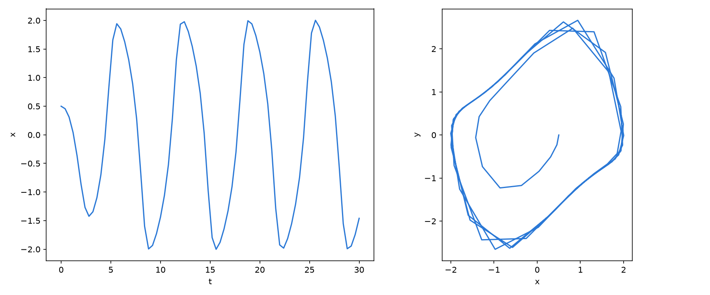
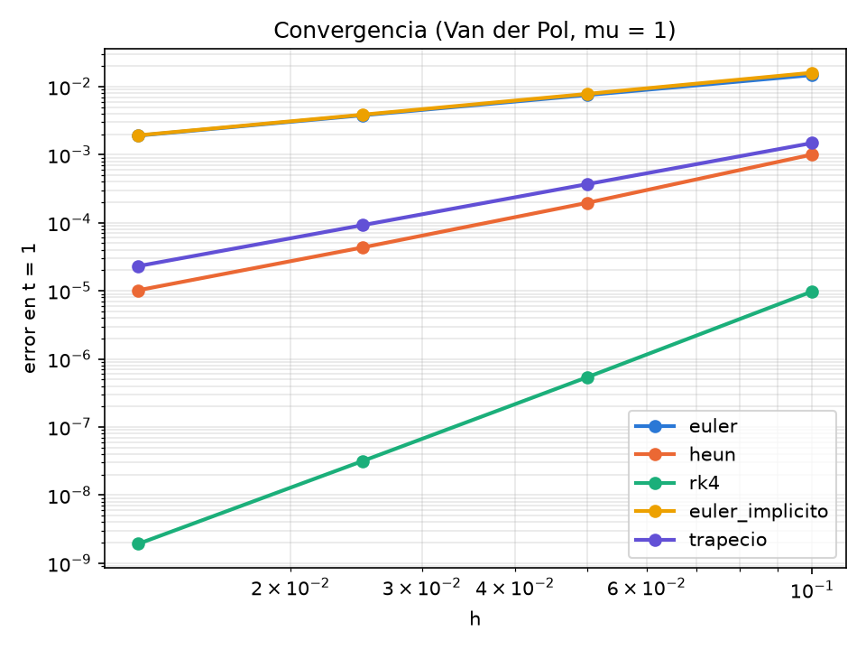
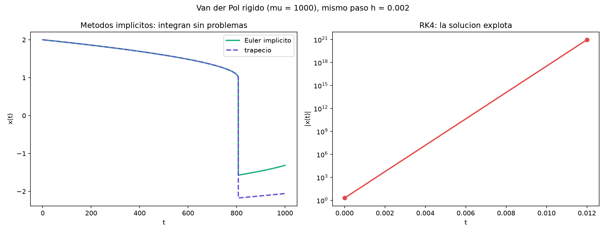

# Unidad 09 · Runge–Kutta

Euler es de orden 1, y ya vimos que con pasos moderados se rompe. Aquí ponemos tres métodos más
en el mismo módulo y usamos el que queramos desde el archivo de entrada:

| Método | Orden | Qué hace |
|---|---:|---|
| `euler` | 1 | `u + h F(u)` |
| `heun` | 2 | promedia la pendiente del principio y la del final del paso |
| `rk4` | 4 | el Runge–Kutta clásico, con cuatro evaluaciones |
| `euler_implicito` | 1 | el de la unidad 05 |
| `trapecio` | 2 | la versión implícita de Heun |

```
09_runge_kutta/
├── modelo.f90         el campo vectorial y su jacobiano
├── runge_kutta.f90    los métodos
├── principal.f90      el programa rk: lee, integra y escribe
├── orden.f90          el programa orden: mide el orden de cada método
├── entrada.nml, rigido_*.nml
├── Makefile
└── graficar.py, graficar_orden.py, graficar_rigido.py
```

```bash
make run                  # RK4 con entrada.nml
python graficar.py
```

Para cambiar de método, edita `metodo` en `entrada.nml`: `euler`, `heun`, `rk4`,
`euler_implicito` o `trapecio`. No hay que recompilar.

## Cómo está escrito

Cada método es una función que recibe el estado `u_k` y devuelve `u_{k+1}`. Este es RK4, tal como
sale en cualquier libro:

```fortran
function paso_rk4(u, mu, h) result(u_nuevo)
    double precision, intent(in) :: u(2), mu, h
    double precision :: u_nuevo(2), k1(2), k2(2), k3(2), k4(2)
    k1 = campo(u, mu)
    k2 = campo(u + h / 2 * k1, mu)
    k3 = campo(u + h / 2 * k2, mu)
    k4 = campo(u + h * k3, mu)
    u_nuevo = u + h / 6 * (k1 + 2 * k2 + 2 * k3 + k4)
end function paso_rk4
```

La subrutina `integrar` recorre los pasos y, en cada uno, elige la función con un `select case`
según el nombre del método. No es lo más eficiente del mundo, porque compara un texto cada paso,
pero se lee de maravilla, y para lo que hacemos la diferencia no se nota.

Los dos implícitos comparten una función, `paso_implicito`, que tiene un parámetro `theta`:
`theta = 1` es Euler implícito y `theta = 1/2` es el trapecio. Resuelve el sistema con Newton,
igual que en la unidad 05.

## ¿Y lo de `h = 0.4`?

En la unidad 06, Euler explícito explotaba con `h = 0.4`. Prueba a poner `h = 0.4` y `rk4`
en `entrada.nml`:



El ciclo límite sale con amplitud 2,00, y casi se ve a simple vista que es el ciclo.

## ¿Cómo sé que está bien escrito?

Midiendo el orden de convergencia. Si un método es de orden `p`, al dividir `h` entre dos el
error se divide por `2^p`. `make run-orden` integra hasta `t = 1` con `h = 0.1, 0.05, 0.025,
0.0125`, compara con una referencia (RK4 con `h = 10⁻⁴`) y calcula el orden:

```
            metodo   orden teorico   orden observado
euler                        1              0.99   OK
heun                         2              2.09   OK
rk4                          4              4.05   OK
euler_implicito              1              1.01   OK
trapecio                     2              2.00   OK
```

```bash
python graficar_orden.py
```



En escala logarítmica, cada método es una recta cuya pendiente es su orden. Es la forma más
barata de descubrir un coeficiente mal escrito: si un orden se desvía, el programa dice
`FALLA`.

## La rigidez

Un último ejemplo: Van der Pol con `mu = 1000`. Con `mu` tan grande aparecen dos escalas de
tiempo muy distintas, y a eso se le llama rigidez. Compara lo que hacen los métodos con el mismo
paso, `h = 0.002`:

```bash
make run-rigido
python graficar_rigido.py
```

```
Metodo: euler_implicito   mu = 1000.0   h = 2.00E-03   pasos = 500000
Pasos hechos: 500000   estado final (x, y) =  -1.312748E+00  1.814911E-03
Metodo: trapecio   mu = 1000.0   h = 2.00E-03   pasos = 500000
Pasos hechos: 500000   estado final (x, y) =  -2.056631E+00  6.367805E-04
Metodo: rk4   mu = 1000.0   h = 2.00E-03   pasos = 500000
La solucion ha explotado en el paso 6, t = 1.20E-02
```



RK4, que es de orden 4, explota a los seis pasos. Los dos implícitos, uno de orden 1 y otro de
orden 2, terminan sin ningún problema. En esta zona, el jacobiano tiene un autovalor de
unos −3000, y RK4 necesitaría un paso por debajo de `10⁻³` para ser estable, aunque la
solución apenas cambie. Es el paso, y no la precisión, lo que limita al método explícito. Los
implícitos no tienen esa restricción.

Eso sí, los dos implícitos son poco precisos: los dos hacen el salto rápido en `t = 807`, pero
después de él cada uno llega a un valor distinto. Para integrar varios ciclos con esta
precisión hacen falta métodos implícitos de orden alto, como los Radau, que se escriben igual pero
con más etapas (RADAU5, de Hairer y Wanner, es un código en Fortran muy conocido).

Esto lo volveremos a ver en la última unidad, con otro disfraz.

## Ejercicios

1. Escribe en Fortran un `paso_ralston`, el método de orden 2 con `k2 = F(u + 2h/3 k1)` y
   `u_nuevo = u + h (k1 + 3 k2) / 4`. Añádelo a `integrar` y comprueba con `orden` que es de orden 2.
2. Rompe un coeficiente de RK4 (cambia el `/ 6` por `/ 7`) y pasa el test. ¿Qué orden sale?
3. Con `mu = 5` y `h = 0.1`, compara Euler, Heun y RK4. ¿Cuál mantiene mejor el ciclo límite?
4. Busca a mano el `h` más grande con el que RK4 no explota con `mu = 1000`. Pon `t_final = 5`
   para no esperar.
