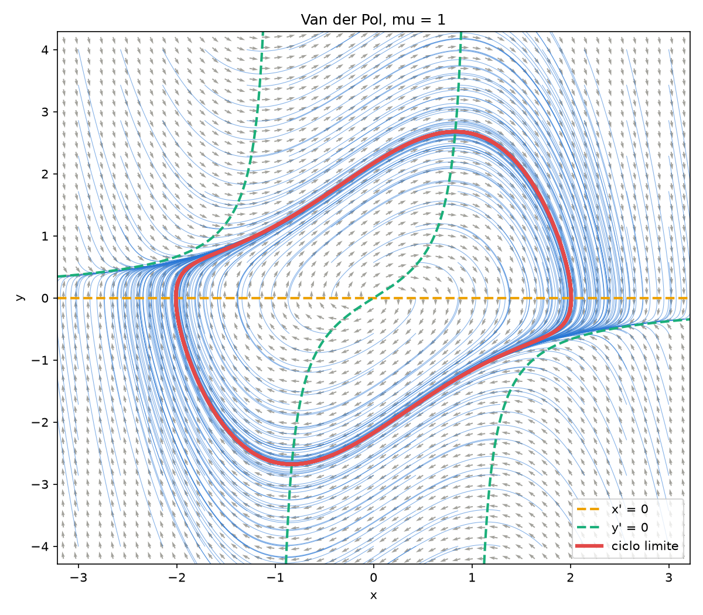
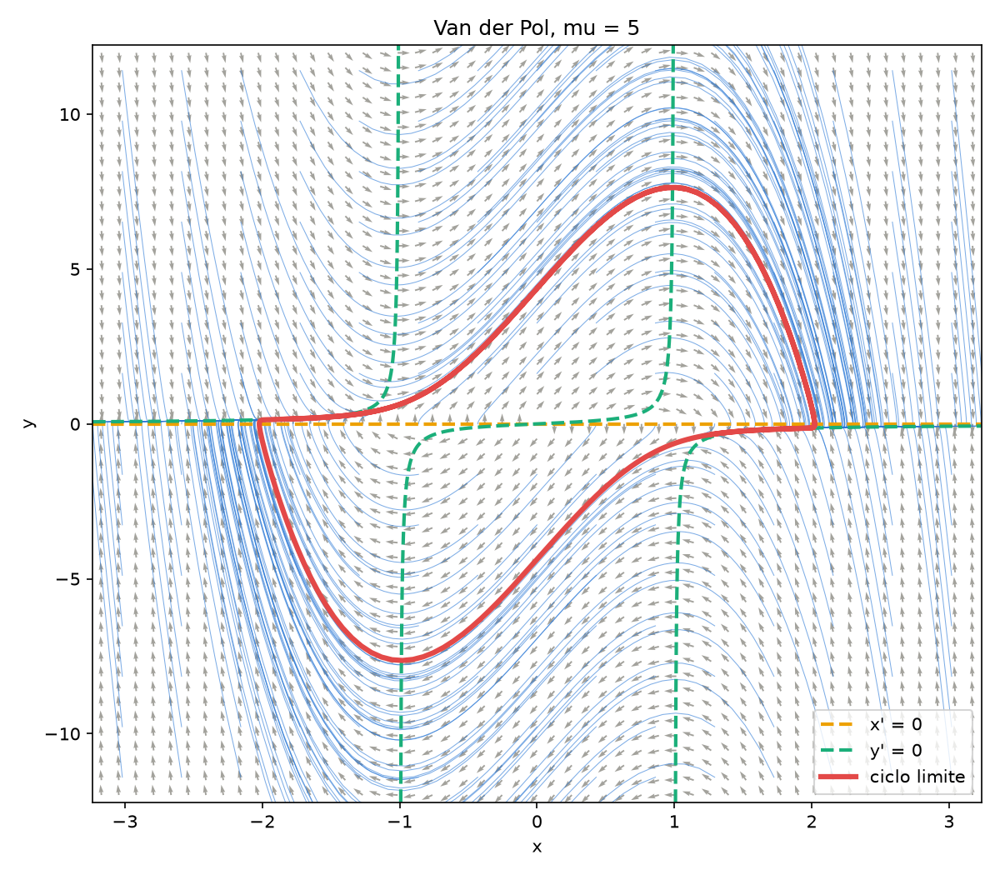

# Unidad 10 · Retrato de fases

Con un integrador comprobado se puede estudiar la dinámica del sistema. Esta unidad no añade métodos:
`modelo.f90` y `runge_kutta.f90` son los de la unidad 09, sin cambios. El único programa nuevo es
`retrato.f90`.

```bash
make run              # tarda alrededor de un segundo
python graficar.py
```

| `mu = 1` | `mu = 5` |
|---|---|
|  |  |

En gris se dibuja el campo de direcciones, en azul las trayectorias, en discontinuo las nulclinas
(los puntos donde `x' = 0` o `y' = 0`) y en rojo el ciclo límite. Todas las trayectorias terminan en
él. Con `mu = 5` el ciclo es de relajación: alterna tramos lentos, próximos a la nulclina, con saltos
rápidos.

## Contenido de `retrato.f90`

El programa escribe cuatro archivos en `resultados/`:

- `ciclo.dat`: el ciclo límite. Se integra un transitorio desde `(2, 0)`, se toma el estado final y se
  continúa desde él; el transitorio se descarta.
- `campo.dat`: flechas `x y dx dy` en una rejilla. Todas tienen la misma longitud, porque solo
  importa la dirección.
- `trayectorias.dat`: las trayectorias desde una rejilla de condiciones iniciales, una a continuación
  de otra.
- `parametros.dat`: `mu` y el tamaño de la caja, que Python necesita para dibujar.

## Dos detalles de Fortran

Con `h = 0.001`, cada trayectoria tiene 10 000 pasos. Un corte con paso escribe solo una parte, sin
bucle:

```fortran
write(unidad, '(2es16.8)') u(:, ::paso_escritura)
```

`u(:, ::10)` son las columnas 0, 10, 20, y así sucesivamente. El formato tiene sitio para dos números,
y Fortran lo repite mientras queden datos, de modo que escribe un estado por línea.

El otro detalle es que un mismo array no puede pasarse como dato y como resultado. Para continuar la
integración desde el final de un tramo hay que hacer una copia:

```fortran
u_inicio = u(:, n_hechos)                              ! copia
call integrar('rk4', u_inicio, mu, h, n, u, n_hechos)  ! correcto
! call integrar('rk4', u(:, n_hechos), mu, h, n, u, n_hechos)   ! incorrecto
```

La línea comentada pasa `u` como estado inicial y como resultado a la vez. El estándar lo prohíbe, y
además `u` se vuelve a reservar al entrar. El error no se manifiesta siempre: un programa así puede
funcionar en un ordenador y fallar en otro, como ocurrió al preparar este curso.

## Ejercicios

1. Cambia `mu` a 5 en el archivo de entrada y observa los tramos lentos junto a la nulclina y los
   saltos.
2. Con `mu = 0.1` el ciclo es casi una circunferencia de radio 2. Comprueba su amplitud con
   `maxval(u(1, :))`.
3. Empieza el transitorio en `(0.01, 0)` en lugar de en `(2, 0)` y comprueba si se llega al mismo
   ciclo.
4. Cambia `'rk4'` por `'euler'` con `h = 0.05` y describe en qué se distingue el retrato.
