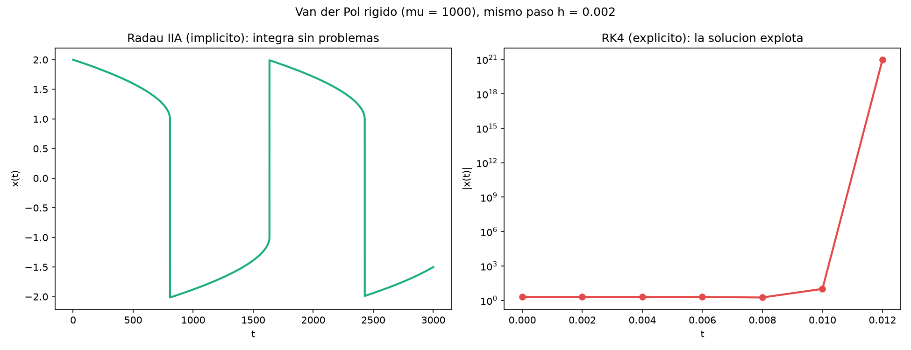
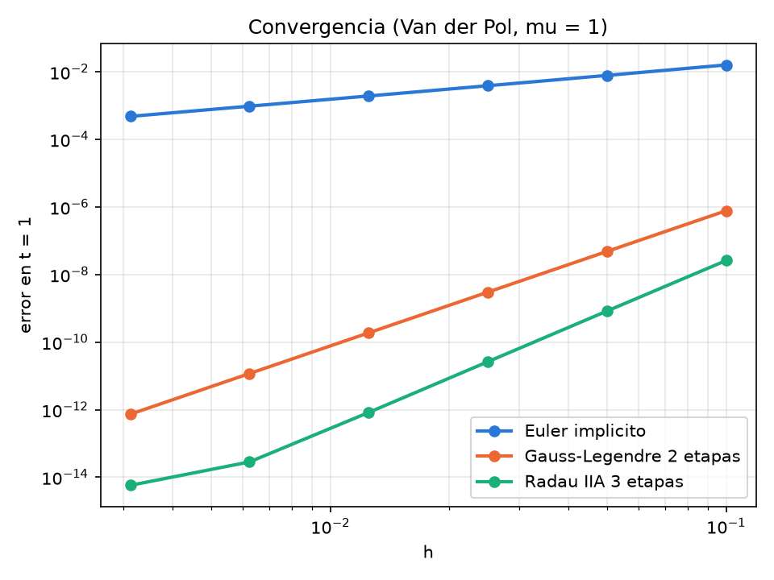

# Unidad 10 · Rigidez y Runge–Kutta implícitos

Terminamos con un problema en el que nuestro RK4 no sirve. Van der Pol con `mu = 1000`
es **rígido**, y RK4 explota con cualquier paso razonable. La solución son los métodos
implícitos que ya vimos en la unidad 06, ahora de alto orden.

En clase lo veremos como demostración; el código se puede leer después con calma.

```bash
make run             # Radau IIA y RK4 con el mismo paso, y figura
make convergencia    # el orden de los métodos implícitos
```

```
Metodo: Radau IIA 3 etapas   mu = 1000.0   h =  2.00E-03   pasos = 1500000
Pasos completados: 1500000   tiempo:  1.20 s
Metodo: RK4 clasico   mu = 1000.0   h =  2.00E-03   pasos = 1500000
La solucion ha explotado (Inf o NaN) en t =  1.400E-02.
Pasos completados: 6   tiempo:  0.00 s
```



## ¿Por qué explota?

Cerca de `x = 2`, el jacobiano tiene un autovalor de unos −3000. Para ser estable, RK4
necesitaría `h` por debajo de `10⁻³`, aunque la solución apenas cambie. Eso es la rigidez:
el paso lo impone la estabilidad, no la precisión. Radau IIA no tiene esa limitación.

## El precio

En cada paso hay que resolver un sistema no lineal con Newton, igual que hacíamos con Euler
implícito, pero ahora de tamaño `2s`. Está en `paso_implicito`, en `src/runge_kutta.f90`, y
se apoya en `src/algebra_lineal.f90`, una eliminación gaussiana escrita a mano para ver
cómo se recorren las matrices. En un código real usarías `dgesv` de LAPACK.

El programa de convergencia es el mismo archivo que en la unidad 08, y ahora mide también
los métodos implícitos:

```
                   metodo   orden teorico   orden observado
          Euler implicito         1              1.00   OK
  Gauss-Legendre 2 etapas         4              4.00   OK
       Radau IIA 3 etapas         5              4.98   OK
```



## Lo nuevo en Fortran

**Argumentos opcionales.** `integrar_rk` tiene un argumento más que en la unidad 08, pero
las llamadas antiguas siguen valiendo:

```fortran
integer, intent(out), optional :: n_hechos
if (present(n_hechos)) n_hechos = k - 1
```

**Detectar `Inf` y `NaN`:**

```fortran
use ieee_arithmetic, only: ieee_is_finite
if (.not. all(ieee_is_finite(u(:, k)))) ...
```

**Cronometrar:**

```fortran
call system_clock(inicio, ticks_por_segundo)
...
call system_clock(fin)
```

Los coeficientes de Gauss–Legendre y Radau IIA son de Hairer y Wanner, *Solving Ordinary
Differential Equations II*, sección IV.5.

## Ejercicios

1. Busca el mayor `h` con el que RK4 no explota. Usa `t_final = 5` para no esperar:
   `./rigidez entrada.nml tableros/rk4.txt resultados/rk4.dat`.
2. Prueba Euler implícito y Gauss–Legendre con `h = 0.002`. ¿Cuánto tardan? ¿Se parecen
   sus `x(3000)` al de Radau?
3. Con Radau y `h = 0.01`, Newton deja de converger en el salto rápido. ¿En qué instante?
   ¿Por qué no basta con ser implícito?
