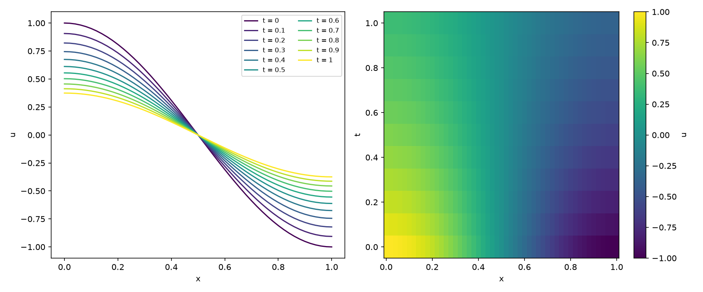
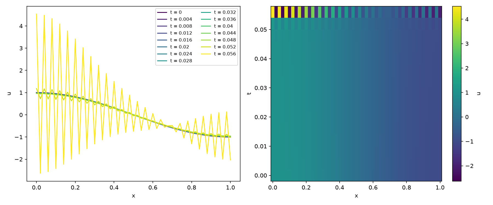
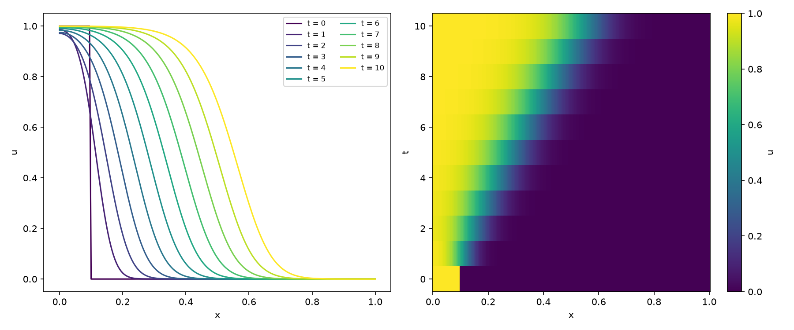

# Unidad 11 · Elementos finitos

Para terminar, un código más grande que junta casi todo lo que hemos visto: módulos, un
Makefile, archivos de entrada, subrutinas con `intent`, arrays dinámicos, cortes de arrays,
Euler explícito e implícito, orden de convergencia y figuras con Python.

El problema es una ecuación en derivadas parciales, la de reacción–difusión:

```
u_t = d u_xx + r u (1 - u),     x en [0, 1],     u_x = 0 en los extremos
```

Si `r = 0`, es la ecuación del calor. Si `r > 0`, es la de Fisher–KPP, que tiene frentes que
avanzan. Y la vamos a resolver con **elementos finitos lineales en una dimensión**.

```bash
make run              # ecuación del calor con Euler implícito
python graficar.py resultados/calor.dat
```

## La idea, muy rápido

En lugar de aproximar en cada punto, aproximamos la solución como una combinación de funciones
"sombrero" `φ_i`, una por nodo (vale 1 en su nodo, 0 en los demás, y es lineal en medio). Al
sustituir en la forma débil de la ecuación sale un sistema de ecuaciones diferenciales
ordinarias:

```
M u' = - d K u + M g(u)         M(i, j) = ∫ φ_i φ_j        K(i, j) = ∫ φ_i' φ_j'
```

con `M` la matriz de masa y `K` la de rigidez. Y eso ya sabemos resolverlo, con Euler. Las
condiciones de contorno de flujo nulo son las naturales en elementos finitos, así que no hay que
hacer nada para imponerlas.

Como cada `φ_i` solo toca a sus vecinos, las dos matrices son **tridiagonales**. Se
construyen elemento a elemento: cada trozo `[x(e), x(e+1)]` aporta una matriz pequeña de 2x2.

## Los archivos

```
11_elementos_finitos/
├── malla.f90          crea los nodos
├── ensamblaje.f90     construye M y K
├── tridiagonal.f90    producto matriz-vector y resolución
├── evolucion.f90      un paso de tiempo, explícito o implícito
├── fem.f90            el programa: lee, avanza en el tiempo y escribe
├── orden_espacial.f90 el programa que mide el orden en el espacio
├── calor.nml, calor_explicito.nml, fisher.nml
├── Makefile
└── graficar.py
```

Quién usa a quién: `fem` usa `malla`, `ensamblaje` y `evolucion`; `evolucion` usa
`tridiagonal`; y `orden_espacial` usa `malla`, `ensamblaje` y `tridiagonal`.

Léelos en este orden: `malla.f90` (veinte líneas), `ensamblaje.f90`, `tridiagonal.f90`,
`evolucion.f90` y por último `fem.f90`, que se parece mucho a los programas principales
anteriores.

Dos detalles. Las matrices tridiagonales simétricas se guardan en dos vectores, `dia` y
`fuera`, y el producto con un vector queda en tres líneas gracias a los cortes de arrays:

```fortran
w = dia * v
w(1:n-1) = w(1:n-1) + fuera * v(2:n)
w(2:n) = w(2:n) + fuera * v(1:n-1)
```

Y resolver el sistema es la eliminación gaussiana de siempre, pero aprovechando que casi todo son
ceros: cuesta `O(n)` en vez de `O(n³)`.

## El tiempo: Euler otra vez

Un paso explícito es `M u_nuevo = M (u + dt g(u)) - dt d K u`. Hay que resolver un sistema con `M`,
pero es muy sencillo. Uno implícito con la difusión en el lado derecho es
`(M + dt d K) u_nuevo = M (u + dt g(u))`, y la matriz `M + dt d K` es siempre la misma, así que
se construye una vez antes del bucle.

## Ecuación del calor, con solución exacta

`calor.nml` parte de `u(x, 0) = cos(π x)`, y la solución exacta es
`exp(-d π² t) cos(π x)`. El programa la compara con la que ha calculado:

```
Elementos: 50   metodo: implicito   dt = 1.00E-02   pasos: 100
Error maximo en los nodos en t_final:   1.69E-03
```



A la izquierda, la solución en varios instantes. A la derecha, el mismo resultado como un mapa
de `x` y `t`.

## Y la rigidez vuelve

Ahora `make run-explicito`: la misma ecuación, la misma malla, con Euler explícito y un paso
de `dt = 0.001`. Es un paso muy pequeño, ¿no? Fíjate en lo que sale:



Hasta `t = 0.05` todo parece ir bien, y de repente aparece un zigzag que crece sin parar. Si
alargas `t_final` hasta 1, el programa te avisa de que la solución explota.

Es la misma historia de la unidad 09. Al discretizar en espacio con `h_x = 0.02` aparecen
autovalores enormes (del orden de `12 d / h_x²`), y Euler explícito necesita
`dt < h_x² / (6 d)`, es decir, unos 0,0007. El implícito no tiene esa restricción, y con
`dt = 0.01` va perfectamente. Cuantos más elementos pongas, más estricto es el límite: aquí
la rigidez no viene de la ecuación, sino de la malla.

## Fisher–KPP

`make run-fisher` resuelve la ecuación con reacción, `r = 1`, desde un escalón en el extremo
izquierdo. Con la difusión implícita y la reacción explícita, avanza con paso 0,05:

```bash
make run-fisher
python graficar.py resultados/fisher.dat
```



El frente avanza hacia la derecha a una velocidad que tiende a `2 √(r d)`, unos 0,063 con estos
valores.

## ¿Es el orden correcto?

Como en la unidad 09, comprobamos el orden de convergencia, esta vez en el espacio:

```bash
make run-orden
```

```
Estiramiento de la malla:  1.0
  elementos     error maximo     orden
         10       7.4366E-03
         20       1.8650E-03      2.00
         40       4.6663E-04      2.00
         80       1.1668E-04      2.00
        160       2.9171E-05      2.00
        320       7.2929E-06      2.00
```

Con elementos lineales, el error se divide por 4 cada vez que duplicas los elementos: orden 2.
El programa lo repite con una malla no uniforme (`estiramiento = 1.5`), con elementos más
pequeños cerca de `x = 0`, y sigue dando orden 2. Esa flexibilidad es una de las ventajas de
los elementos finitos: el código de `ensamblaje.f90` ya funciona para cualquier malla, porque
cada elemento usa su propia longitud.

## Ejercicios

1. Prueba `estiramiento = 2` en `calor.nml`. ¿Cambia el error?
2. Con `calor_explicito.nml`, busca por tanteo el `dt` más grande que no explota. ¿Coincide con
   `h_x² / (6 d)`? Hazlo también con 100 elementos.
3. En `fisher.nml`, mide la velocidad del frente y compárala con `2 √(r d)`. Hará falta una malla
   más larga o un `t_final` mayor.
4. Cambia la condición inicial a un escalón en el centro del intervalo. ¿Qué pasa con los dos
   frentes?
5. Para atreverse: cambia las condiciones de contorno a `u = 0` en los extremos. Tendrás que
   modificar las matrices en la primera y la última fila.
