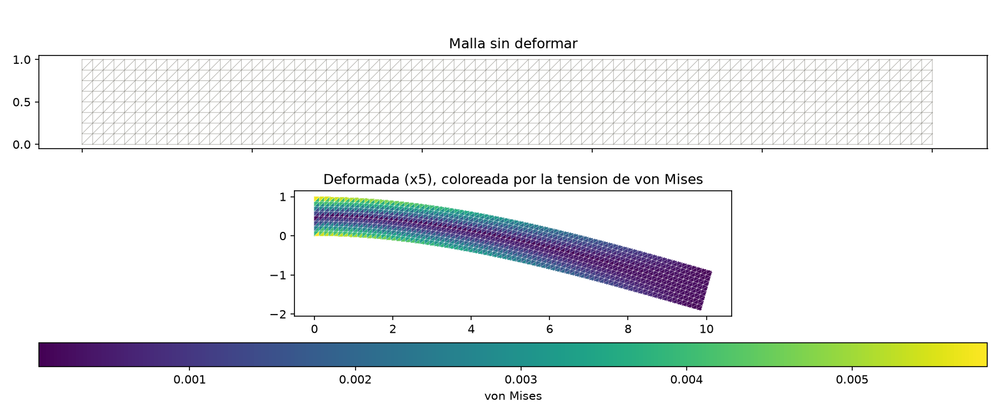
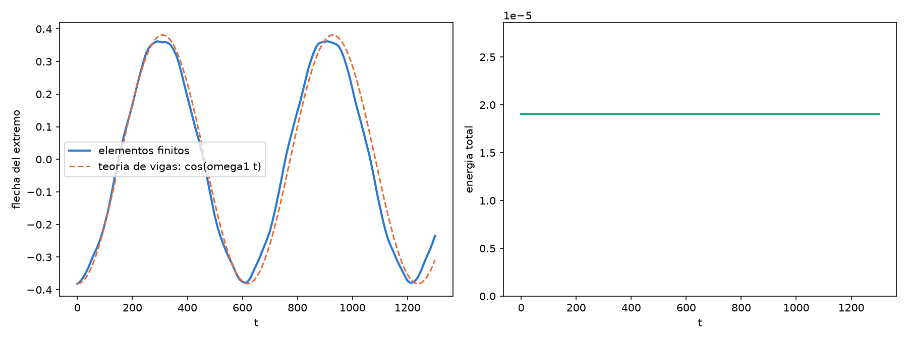

# Unidad 11 · Elementos finitos

Para terminar, un código más grande que junta casi todo lo que hemos visto: módulos, Makefile,
archivos de entrada, subrutinas con `intent`, arrays dinámicos, Euler y su estabilidad, orden de
convergencia y figuras con Python.

El problema es una **viga en voladizo**: un rectángulo de 10 × 1, empotrado en su lado izquierdo y con
una fuerza hacia abajo en el derecho. Lo resolvemos con elementos finitos en 2D, con las ecuaciones de la
elasticidad lineal. Es bastante más que el calor: la incógnita es un vector (el desplazamiento de cada
punto), hay una malla de triángulos, y además de calcular cómo se deforma la viga, vamos a soltarla y ver
cómo vibra.

```bash
make run
python graficar.py
```

```
Malla: 729 nodos, 1280 triangulos, 1458 incognitas
Flecha en el extremo:                 -3.815E-01
Teoria de vigas (Euler-Bernoulli):    -4.000E-01
Cociente:                              0.954
```



La viga se dobla, y la tensión de von Mises (el color) es máxima arriba y abajo, junto al empotramiento,
y casi nula en la línea central. Es lo que dice la teoría de vigas.

## La idea, muy rápido

Dividimos la viga en triángulos. En cada nodo hay dos incógnitas, el desplazamiento horizontal y el
vertical, y dentro de cada triángulo el desplazamiento se interpola linealmente entre sus tres vértices.
Con eso, la deformación dentro de un triángulo es constante y sale de un producto `B u_e`, la tensión es
`D B u_e`, y la energía elástica del triángulo da su matriz de rigidez:

```
K_e = área · Bᵀ D B
```

(`B` contiene las derivadas de las funciones de forma, y `D` el material: módulo de Young y coeficiente de
Poisson). La matriz de rigidez global, `K`, es la suma de todas las `K_e`, cada una colocada en las
filas y columnas de sus tres nodos. Eso es el **ensamblaje**. Y con la fuerza `f`, la estática es

```
K u = f
```

## Los archivos

```
11_elementos_finitos/
├── malla.f90           crea los nodos y los triángulos
├── elasticidad.f90     las matrices B y D, y el ensamblaje de K y de la masa
├── algebra.f90         resolutor de sistemas lineales (Cholesky)
├── dinamica.f90        los dos métodos de integración en el tiempo
├── solido.f90          el programa: lee, resuelve y escribe
├── orden_espacial.f90  el programa que mide el orden de convergencia
├── *.nml               los parámetros de cada caso
├── Makefile
└── graficar.py, graficar_vibracion.py
```

`solido` usa `malla`, `elasticidad`, `algebra` y `dinamica`; `dinamica` usa `algebra`; y `orden_espacial`
usa `malla`, `elasticidad` y `algebra`. Léelos en ese orden: `malla.f90` es corto, `elasticidad.f90` es el
corazón del método, y `solido.f90` se parece mucho a los programas principales de las unidades anteriores.

Algunas cosas de Fortran que aparecen aquí:

- **Arrays de dos dimensiones para los nodos y los triángulos.** `x(:, i)` son las coordenadas del nodo
  `i`, y `tri(:, e)`, los tres nodos del triángulo `e`. Cada columna es un objeto, como en la unidad 04.
- **Índices con vectores.** Para ensamblar, `k(gl, gl) = k(gl, gl) + ke` suma una matriz de 6x6 en las
  seis filas y columnas que indica el vector `gl`. Es como indexar con un vector en Matlab o Julia.
- **`pack`**, para quedarnos con las incógnitas libres. La viga está empotrada a la izquierda, así que los
  desplazamientos de esos nodos son cero y no son incógnitas. `libres = pack([(i, i = 1, 2*n)], .not. fijo)`
  da la lista de los demás, y la submatriz del sistema es `k(libres, libres)`.
- **El resolutor.** La matriz de rigidez es simétrica y definida positiva, así que usamos la factorización
  de Cholesky, `K = L Lᵀ`, y después resolvemos dos sistemas triangulares. No es lo más rápido (la matriz es
  casi toda ceros) pero cabe en veinte líneas. En un código real se usaría una matriz dispersa, o LAPACK
  (`dpotrf` y `dpotrs` hacen esto mismo).

## ¿Está bien?

Hay dos formas de comprobarlo. La primera es comparar con la teoría de vigas, y es lo que imprime el
programa: la flecha del extremo debería ser `P L³ / (3 E I)`. Pero fíjate: con `ny = 4` casillas en el
canto, el cociente sale 0,83. Los triángulos lineales son demasiado rígidos a flexión, y hay que refinar:

| casillas (nx × ny) | flecha / teoría |
|---|---:|
| 20 × 2 | 0,54 |
| 40 × 4 | 0,83 |
| 80 × 8 | 0,95 |
| 120 × 12 | 0,98 |

La otra es medir el orden de convergencia, como en la unidad 09. Para eso hace falta una solución exacta,
que no tenemos para la viga. La solución es inventarse una: elegimos un desplazamiento
`ux = sin(πx) sin(πy)`, `uy = 0` en el cuadrado unidad (que vale cero en todo el borde), lo sustituimos en
las ecuaciones y calculamos qué fuerza lo produciría. Si resolvemos con esa fuerza, la solución exacta es
la que elegimos, y podemos medir el error.

```bash
make run-orden
```

```
  casillas     error maximo     orden
         4       7.4906E-02
         8       1.9270E-02      1.96
        16       4.8970E-03      1.98
        32       1.2307E-03      1.99
OK: orden 2.
```

Con triángulos lineales, el error se divide por cuatro al duplicar las casillas: orden 2.

## Soltar la viga

Ahora la parte dinámica. Partimos de la deformación estática, soltamos la viga, y sin rozamiento oscilará
para siempre. La ecuación es `M u'' + K u = 0`, donde `M` es la matriz de masa (aquí, un vector: cada
triángulo reparte un tercio de su masa en cada nodo). Un sistema de ecuaciones diferenciales ordinarias,
y eso ya lo sabemos resolver. Con dos métodos, que son los de siempre:

- **Explícito** (velocidad Verlet). Es barato, un producto de matriz por vector por paso, pero solo es
  estable si `dt < 2 / ω_max`, donde `ω_max` es la mayor frecuencia de la malla.
- **Implícito** (Newmark, aceleración media). En cada paso resuelve un sistema, pero es estable con
  cualquier `dt`. Es la regla del trapecio de la unidad 09, aplicada al sistema de primer orden
  `u' = v`, `M v' = -K u`. La matriz del sistema es siempre la misma, así que se factoriza una vez
  antes del bucle.

El programa calcula `ω_max` con el método de la potencia (multiplica un vector por `M⁻¹K` una y otra vez,
hasta que se alinea con el autovector dominante) y te dice cuál es el paso máximo del explícito.

```bash
make run-vibracion
python graficar_vibracion.py
```



A la izquierda, la flecha del extremo y la frecuencia que daría la teoría de vigas. El periodo de la
simulación es 610, frente a 619 de la teoría (con la malla de 40 × 4 saldría 565: de nuevo la rigidez de
los triángulos lineales). La curva no es una sinusoide perfecta porque soltamos la viga desde su
deformación estática, que no es exactamente el primer modo y excita también otros. A la derecha, la
energía, que se conserva: es lo que se espera de este método.

Con `dt = 2` el implícito da dos periodos en 650 pasos. Ahora el explícito:

```bash
make run-explicito
```

Con `dt = 0.07`, justo por debajo del máximo (0,083), funciona y da el mismo resultado que el implícito
hasta nueve cifras. Pero necesita treinta veces más pasos, y por eso solo simulamos hasta `t = 200`.
Y si pasas del máximo:

```bash
make run-inestable
```

```
Paso maximo del metodo explicito:        2 / omega_max =  8.273E-02
Metodo: explicito   dt = 1.000E-01
La solucion ha explotado en t =  2.400E+00
```

Con `dt = 0.1`, solo un veinte por ciento por encima del límite, la solución explota en 24 pasos. Es la
rigidez de la unidad 09 con otro disfraz: las frecuencias altas de la malla, que no nos interesan, son las
que mandan sobre el paso. Y cuanto más fina es la malla, más altas son y más pequeño tiene que ser el paso.

## Ejercicios

1. Con `estatico.nml`, prueba mallas de 20 × 2, 40 × 4, 80 × 8 y 120 × 12, y comprueba la tabla de arriba.
   ¿Cuánto tarda cada una?
2. Ponle a la viga el doble de espesor (`ly = 2`). ¿Cuánto cambia la flecha? ¿Y si es el doble de larga?
   Compara con lo que dice la teoría, que es proporcional a `L³ / ly³`.
3. En `vibracion_explicito.nml` busca por tanteo el `dt` más grande que no explota. ¿Coincide con el que
   calcula el programa? Haz lo mismo con una malla de 40 × 4.
4. Cambia `nu` a `0.49` (casi incompresible). ¿Qué pasa con la flecha? ¿Y con la frecuencia máxima?
5. Para atreverse: cambia las condiciones de contorno para empotrar también el lado derecho, y dibuja la
   deformación con una fuerza hacia abajo repartida en todo el cuerpo (`m * g` en cada nodo).
