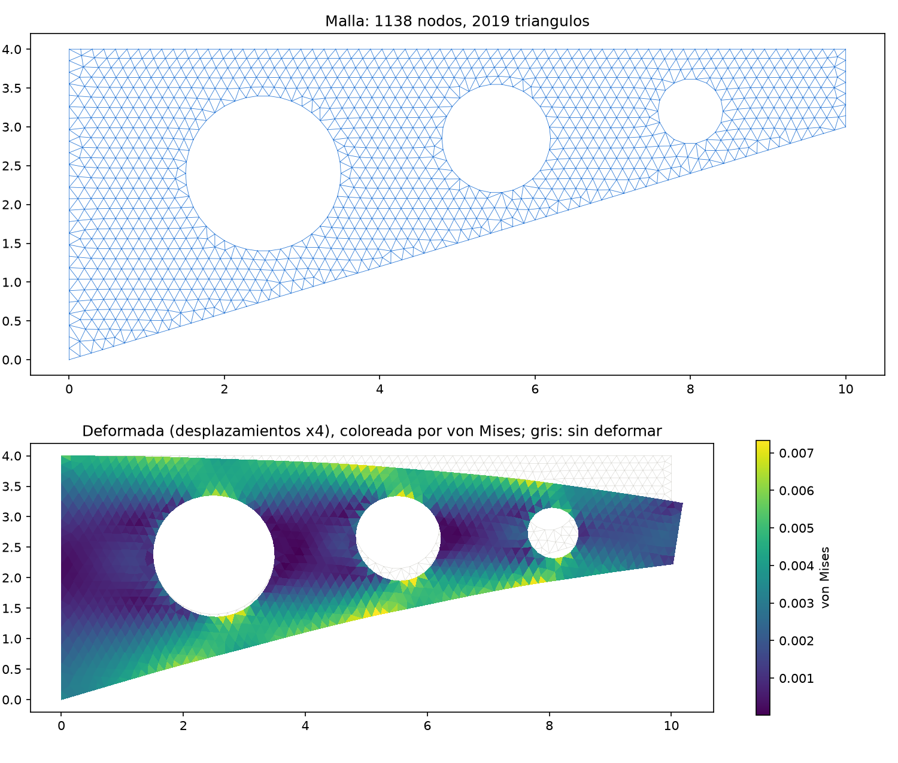
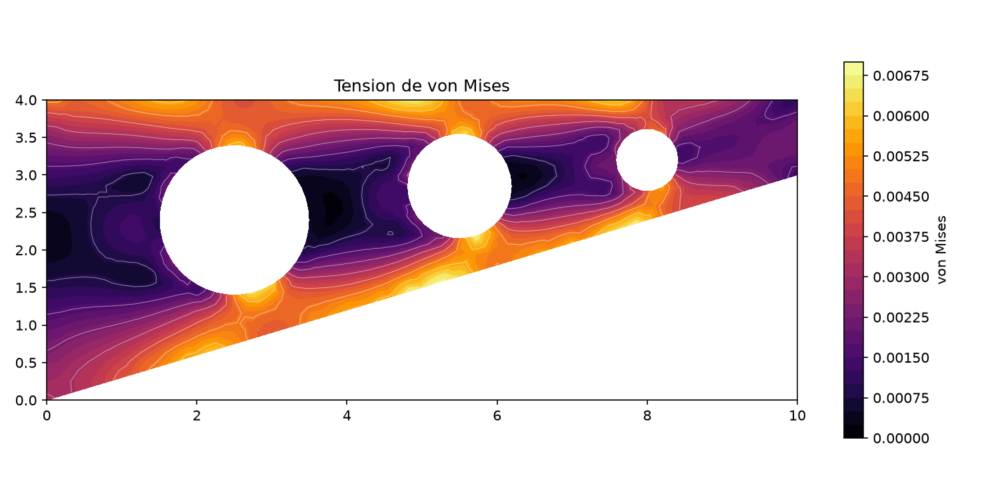
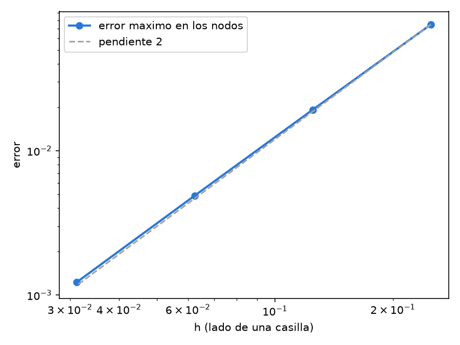
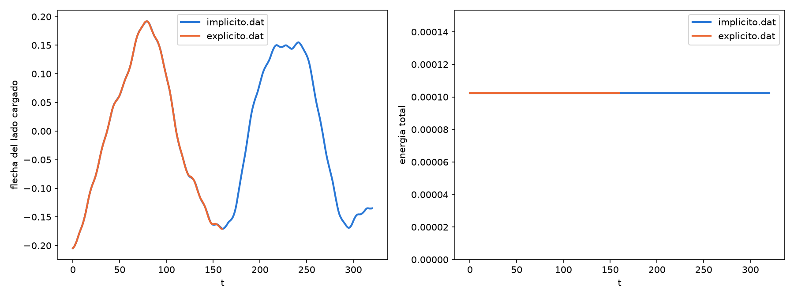

# Unidad 11. Elementos finitos

Un código más largo que reúne lo anterior: módulos, Makefile, archivos de entrada, subrutinas con
`intent`, arrays dinámicos, métodos explícitos e implícitos, orden de convergencia y figuras.

El problema es una **ménsula**: una pieza en voladizo que se estrecha desde la pared hasta el
extremo, con tres agujeros para aligerarla. Está empotrada por el lado izquierdo y tiene una fuerza
hacia abajo repartida por el lado derecho. Se resuelve con elementos finitos en 2D y elasticidad
lineal: la incógnita es el desplazamiento de cada punto y la malla es de triángulos. Además de la
deformación, se calculan las vibraciones de la pieza cuando se suelta.

```bash
make run
python graficar.py
```

```
Malla mensula.malla: 1138 nodos, 2019 triangulos, 2276 incognitas
Flecha del lado cargado:         -2.047E-01
Tension de von Mises maxima:      7.336E-03
Resultados en resultados/
```



## Tensión de von Mises

La tensión de von Mises resume en un número el estado de tensión de cada punto, y se compara con el
límite del material para saber si aguanta. Es constante en cada triángulo; para la figura, el valor
de cada nodo es la media de los triángulos que lo tocan:



Los bordes superior e inferior trabajan a tracción y a compresión, como en una viga, y la zona
central apenas trabaja, que es por lo que se puede vaciar. Las tensiones máximas aparecen en el borde
inferior y en los puntos de los agujeros más próximos a los bordes, donde el material que queda es
más estrecho.

## La malla

Una rejilla rectangular no sirve para una pieza con agujeros. La malla la genera
`generar_malla.py`: reparte nodos por el contorno y por los agujeros, rellena el interior con una
rejilla de triángulos equiláteros, los une con una triangulación de Delaunay y quita los triángulos
que quedan fuera de la pieza.

```bash
python generar_malla.py                 # mensula.malla y viga.malla
python generar_malla.py viga 0.25       # la viga, con triángulos de lado 0.25
```

El archivo es de texto: una línea de comentario, el número de nodos y de triángulos, una línea por
nodo (`x y fijo peso`) y una por triángulo (sus tres nodos). `fijo` vale 1 en los nodos empotrados, y
`peso` es la fracción de la carga que recibe cada nodo. `leer_malla`, en `malla.f90`, lo lee con
`read(unidad, *)`. Es lo que se hace en un código de investigación, con mallas creadas por programas
como [Gmsh](https://gmsh.info).

## Método

Cada nodo tiene dos incógnitas (desplazamiento horizontal y vertical), y dentro de cada triángulo el
desplazamiento es lineal. La deformación es entonces constante en cada triángulo, `B u_e`, la tensión
es `D B u_e`, y la matriz de rigidez del triángulo es

```
K_e = área * Bᵀ D B
```

(`B` contiene las derivadas de las funciones de forma, y `D` el material). La matriz global `K` es la
suma de las `K_e`, cada una colocada en las filas y columnas de sus tres nodos: el **ensamblaje**. La
estática es `K u = f`.

## Archivos

```
11_elementos_finitos/
├── malla.f90           lectura de la malla (y una rejilla para el cuadrado)
├── elasticidad.f90     matrices B y D, ensamblaje de K y de la masa
├── algebra.f90         resolución de sistemas (Cholesky)
├── dinamica.f90        integración en el tiempo
├── solido.f90          programa principal
├── orden_espacial.f90  programa que mide el orden de convergencia
├── generar_malla.py, mensula.malla, viga.malla
├── *.nml, Makefile
└── graficar.py, graficar_orden.py, graficar_vibracion.py
```

`solido` usa `malla`, `elasticidad`, `algebra` y `dinamica`; `dinamica` usa `algebra`; y
`orden_espacial` usa `malla`, `elasticidad` y `algebra`. Elementos de Fortran que aparecen:

- `x(:, i)` son las coordenadas del nodo `i`, y `tri(:, e)`, los tres nodos del triángulo `e`.
- `k(gl, gl) = k(gl, gl) + ke` suma una matriz de 6×6 en las filas y columnas que indica el vector
  `gl`, como indexar con un vector en Matlab o Julia.
- `fijo(1::2) = fijo_nodo` rellena las posiciones impares (los `ux`) de un vector con un corte con
  paso.
- Los nodos empotrados no son incógnitas. `libres = pack([(i, i = 1, 2*n)], .not. fijo)` da la lista
  de grados de libertad restantes, y el sistema es `k(libres, libres)`.
- La matriz de rigidez es simétrica y definida positiva, y se resuelve con Cholesky (`K = L Lᵀ`) y dos
  sistemas triangulares. Es densa y no es el método más rápido; en un código real se usaría una matriz
  dispersa o LAPACK (`dpotrf`, `dpotrs`).

## Verificación

La ménsula no tiene solución exacta, así que el código se comprueba con dos problemas que sí la
tienen. El primero es una viga recta de 10 × 1 con la misma carga, cuya flecha, según la teoría de
vigas, es `P L³ / (3 E I) = -0.4`:

```bash
make run-viga
```

Los triángulos lineales son demasiado rígidos a flexión, y el cociente se acerca a 1 al refinar:

| Lado de los triángulos | Nodos | Flecha / teoría |
|---|---:|---:|
| 0,5 | 62 | 0,65 |
| 0,25 | 242 | 0,92 |
| 0,125 | 804 | 0,98 |
| 0,1 | 1205 | 0,99 |

El segundo sirve para medir el orden de convergencia. Se elige un desplazamiento,
`ux = sin(πx) sin(πy)`, `uy = 0` en el cuadrado unidad (nulo en todo el borde), se sustituye en las
ecuaciones y se calcula la fuerza que lo produce. Resolviendo con esa fuerza, la solución exacta es la
elegida:

```bash
make run-orden
python graficar_orden.py
```

```
  casillas     error maximo     orden
         4       7.4906E-02
         8       1.9270E-02      1.96
        16       4.8970E-03      1.98
        32       1.2307E-03      1.99
OK: orden 2.
```



## Vibraciones

Se parte de la deformación estática y se suelta la pieza. La ecuación es `M u'' + K u = 0`, con `M`
diagonal (cada triángulo reparte un tercio de su masa en cada nodo). Se resuelve con dos métodos:

- **Explícito** (velocidad Verlet): un producto matriz-vector por paso, pero solo es estable si
  `dt < 2 / ω_max`, con `ω_max` la mayor frecuencia de la malla.
- **Implícito** (Newmark, aceleración media): resuelve un sistema en cada paso y es estable con
  cualquier `dt`. Es la regla del trapecio de la unidad 09 aplicada al sistema `u' = v`,
  `M v' = -K u`. Su matriz es la misma en todos los pasos y se factoriza una vez.

El programa calcula `ω_max` con el método de la potencia e imprime el paso máximo del explícito.

```bash
make run-vibracion
cp resultados/flecha.dat resultados/implicito.dat
make run-explicito
cp resultados/flecha.dat resultados/explicito.dat
python graficar_vibracion.py resultados/implicito.dat resultados/explicito.dat
```



Izquierda: flecha del lado cargado. El periodo es de unos 155, y la curva no es una sinusoide porque
la deformación inicial excita varios modos de vibración. Derecha: la energía total, que se conserva
con los dos métodos.

El implícito usa `dt = 0.5` y recorre dos periodos en 640 pasos. El explícito, con `dt = 0.06`, da
la misma curva (la diferencia es menor que un 1 % de la amplitud), pero necesita un paso ocho veces
más pequeño. Con un paso un 20 % por encima del límite:

```bash
make run-inestable        # dt = 0.085
```

```
Paso maximo del metodo explicito:   2 / omega_max =  7.052E-02
Metodo: explicito   dt = 8.500E-02
La solucion ha explotado en t =  3.570E+00
```

explota en 42 pasos. Es la rigidez de la unidad 09: las frecuencias más altas de la malla, sin interés
físico, fijan el paso, y son más altas cuanto más pequeños son los triángulos.

## Ejercicios

1. Genera la viga con triángulos de lado 0.5, 0.25 y 0.125 (`python generar_malla.py viga 0.25`) y
   comprueba la tabla de la flecha.
2. En `generar_malla.py`, cambia el radio de los agujeros de la ménsula, genera la malla y compara la
   flecha y la tensión máxima con las de la pieza original.
3. En `vibracion_explicito.nml`, busca por tanteo el mayor `dt` que no explota y compáralo con el
   que imprime el programa.
4. Pon `nu = 0.49` y observa cómo cambia la flecha.

## Bibliografía

- O. C. Zienkiewicz, R. L. Taylor y J. Z. Zhu, *The Finite Element Method: Its Basis and
  Fundamentals*, 7.ª ed., Butterworth-Heinemann, 2013.
- T. J. R. Hughes, *The Finite Element Method: Linear Static and Dynamic Finite Element Analysis*,
  Dover, 2000. Incluye los métodos de Newmark y su estabilidad.
- C. Johnson, *Numerical Solution of Partial Differential Equations by the Finite Element Method*,
  Dover, 2009. Más matemático, con el análisis de error.
- S. P. Timoshenko y J. N. Goodier, *Theory of Elasticity*, 3.ª ed., McGraw-Hill, 1970.
- N. M. Newmark, «A method of computation for structural dynamics», *Journal of the Engineering
  Mechanics Division (ASCE)* 85 (1959), 67–94.
- P.-O. Persson y G. Strang, «A simple mesh generator in MATLAB», *SIAM Review* 46 (2004), 329–345.
  Un mallador corto, con la misma idea que `generar_malla.py`.
- C. Geuzaine y J.-F. Remacle, «Gmsh: a 3-D finite element mesh generator with built-in pre- and
  post-processing facilities», *International Journal for Numerical Methods in Engineering* 79
  (2009), 1309–1331.
