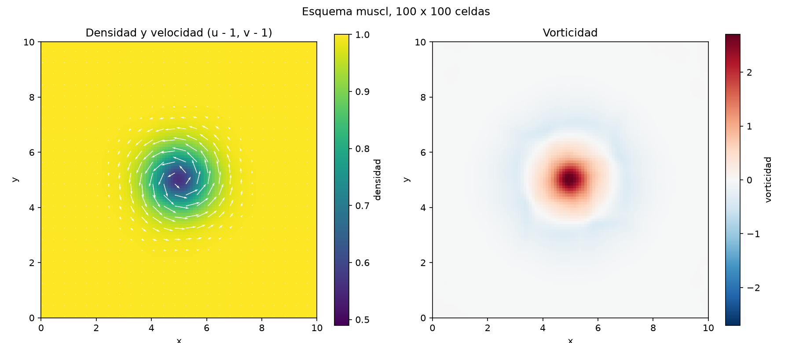
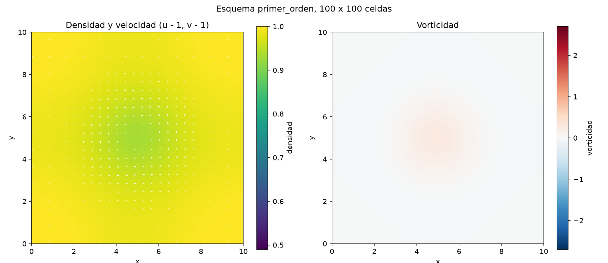
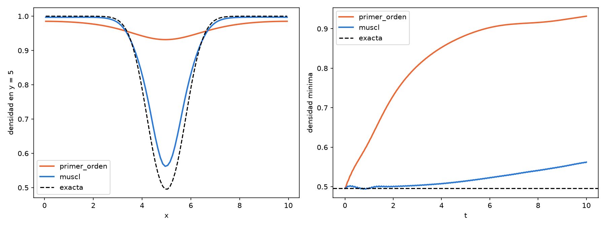
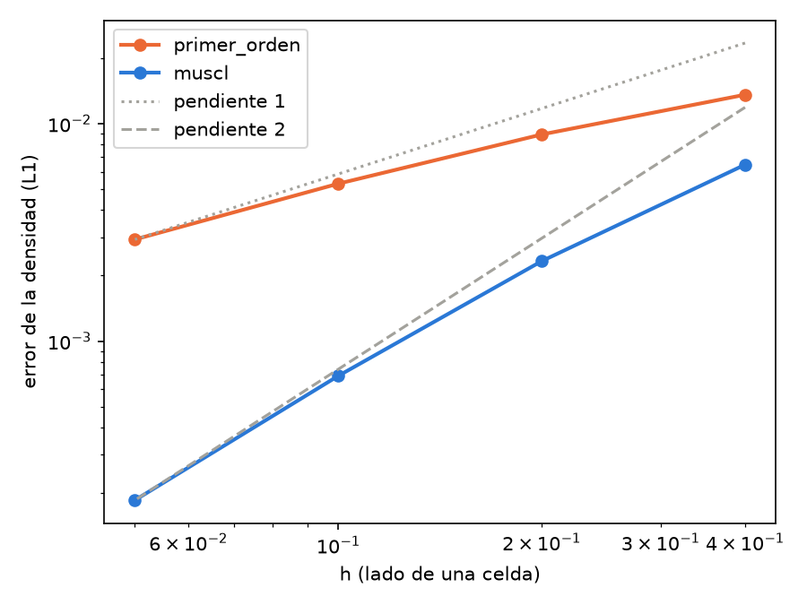

# Unidad 12 · Volúmenes finitos

Un segundo código largo, ahora de fluidos: un **vórtice** arrastrado por un gas, en 2D. Tiene la
misma estructura que el de la unidad 11 (módulos, Makefile, archivos de entrada, programa de orden de
convergencia y figuras en Python), y el avance en el tiempo es el método de Heun de la unidad 09.

```bash
make run
python graficar.py
```

```
Esquema: muscl   celdas: 100 x 100
Pasos: 1057   t final = 10.00
Densidad minima:  0.5622   exacta:  0.4938
Error de la densidad (norma L1): 5.187E-03
Resultados en resultados/muscl_*.dat
```



## El problema

Las ecuaciones de Euler describen un gas sin viscosidad. Expresan que la masa, la cantidad de
movimiento y la energía se conservan:

```
q_t + f(q)_x + g(q)_y = 0,        q = (rho, rho u, rho v, E)
```

con la densidad `rho`, la velocidad `(u, v)` y la energía por unidad de volumen `E`. La presión es
`p = (gamma - 1) (E - rho (u² + v²) / 2)`, con `gamma = 1.4` (aire). En la dirección `x`, el flujo es

```
f = (rho u,  rho u² + p,  rho u v,  u (E + p))
```

y `g` es lo mismo en la dirección `y`.

El caso que se resuelve es el **vórtice isentrópico**: un remolino en el que la densidad y la presión
son mínimas en el centro, y que una corriente de velocidad `(1, 1)` arrastra sin deformarlo. Se conoce
la solución exacta en cualquier instante, así que se puede medir el error. El dominio es el cuadrado
`[0, 10] × [0, 10]` con condiciones periódicas: lo que sale por un lado entra por el opuesto, y en
`t = 10` el vórtice vuelve a su posición inicial.

## Método

El cuadrado se divide en `n × n` celdas, y la incógnita es la **media** de `q` en cada celda. Al
integrar la ecuación en una celda, su media solo cambia por lo que atraviesa sus cuatro caras:

```
d q_ij / dt = -(F_{i+1/2,j} - F_{i-1/2,j}) / dx - (G_{i,j+1/2} - G_{i,j-1/2}) / dx
```

Lo que sale de una celda entra en la vecina, y por eso la masa, la cantidad de movimiento y la
energía totales se conservan exactamente. Es la propiedad que hace de los volúmenes finitos el
método más usado en fluidos.

El flujo de cada cara se calcula con los estados a uno y otro lado, `w_izq` y `w_der`, con el
**flujo de Rusanov**: la media de los dos flujos más un término de difusión proporcional a la mayor
velocidad de las ondas, `s = |u| + c` (con `c` la velocidad del sonido):

```
F = (f(w_izq) + f(w_der)) / 2  -  s (q(w_der) - q(w_izq)) / 2
```

Los estados de la cara se obtienen de dos formas (parámetro `esquema`):

- **`primer_orden`**: el valor medio de cada celda. Es sencillo y robusto, pero muy difusivo.
- **`muscl`**: en cada celda se reconstruye una recta, y se evalúa en la cara. La pendiente se elige
  con el limitador **minmod** (la menor de las dos pendientes vecinas, o cero si tienen distinto
  signo), que evita oscilaciones. Es de orden 2.

El paso de tiempo se elige en cada paso para que la información no recorra más de una fracción `cfl`
de celda: `dt = cfl · dx / max(s_x + s_y)`. Es la misma restricción de estabilidad que en el método
explícito de la unidad 11.

## Archivos

```
12_volumenes_finitos/
├── gas.f90             variables, flujo y velocidad de las ondas del gas
├── volumenes.f90       celdas fantasma, flujo en las caras y paso de tiempo
├── vortice.f90         la solución exacta
├── fluido.f90          programa principal
├── orden_espacial.f90  programa que mide el orden de convergencia
├── vortice.nml, vortice_primer_orden.nml, Makefile
└── graficar.py, graficar_comparacion.py, graficar_orden.py
```

`volumenes` y `vortice` usan `gas`; los dos programas usan los tres módulos. Elementos de Fortran
que aparecen:

- `q(4, -1:n+2, -1:n+2)`: un array que empieza en `-1`. Las celdas `-1, 0` y `n+1, n+2` son
  **celdas fantasma**, que copian las del lado opuesto. Así, las celdas del borde se calculan con el
  mismo código que las demás.
- `q(:, -1:, -1:)` como argumento: forma asumida con el primer índice que se indique. Sin `-1:`, dentro
  de la subrutina los índices empezarían en 1.
- `double precision :: q1(size(q, 1), -1:size(q, 2) - 2, -1:size(q, 3) - 2)`: un array **automático**,
  cuyo tamaño depende de los argumentos y que desaparece al salir de la subrutina.
- `elemental function minmod(a, b)`: una función escrita para escalares que se puede llamar con
  arrays, componente a componente, como `sin`.

## Resultados

Con 100 × 100 celdas, después de una vuelta (`t = 10`):

```bash
make run-primer-orden
python graficar.py primer_orden
python graficar_comparacion.py
```



Con las mismas escalas de color, el esquema de primer orden casi ha borrado el vórtice: la densidad
mínima pasa de 0,49 a 0,93 y la vorticidad máxima, de 2,6 a 0,25. La difusión del esquema se comporta
como una viscosidad que el gas real no tiene.



Izquierda: densidad a lo largo de la recta `y = 5`. Derecha: densidad mínima en función del tiempo,
que en la solución exacta es constante. MUSCL conserva la forma del vórtice, aunque el limitador
recorta el mínimo (0,56 frente a 0,49), porque en un extremo hace la pendiente nula.

## Orden de convergencia

```bash
make run-orden
python graficar_orden.py
```

```
  celdas    error primer_orden   orden    error muscl   orden
      25        1.3570E-02                6.4709E-03
      50        8.9090E-03    0.61        2.3302E-03    1.47
     100        5.2909E-03    0.75        6.9164E-04    1.75
     200        2.9323E-03    0.85        1.8549E-04    1.90
OK: orden 1 y orden 2.
```



Se integra hasta `t = 1`. Los órdenes se acercan a 1 y a 2 al refinar, pero despacio: con mallas
gruesas el error es comparable al propio vórtice, y el comportamiento asintótico solo aparece con
celdas mucho menores que su radio.

## Ejercicios

1. Prueba `beta = 7` y `beta = 10` y compara la densidad mínima calculada con la exacta. Con
   `beta = 10` el centro del vórtice está casi vacío.
2. Busca el mayor `cfl` con el que el esquema `muscl` no explota.
3. Mide cuánto tarda `make run` con `n = 50, 100` y `200`. Al duplicar `n`, ¿por cuánto se
   multiplica el tiempo? Ten en cuenta que el número de pasos también se duplica.
