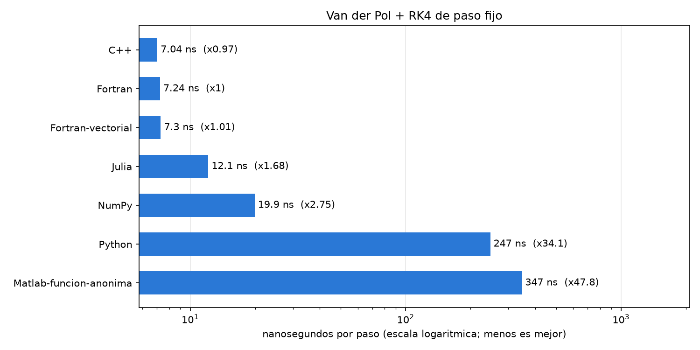

# Curso introductorio de FORTRAN orientado a la investigación

**Ángel Pita da Veiga Ramonde** · Universidade de Santiago de Compostela (USC) y CITMAGA

Este curso son dos sesiones de dos horas para investigadores que ya programan
en Julia, C++ o Matlab y nunca han tocado Fortran. Vamos poco a poco: empezamos
con un hola mundo y terminamos con un integrador de Runge–Kutta implícito capaz
de resolver problemas rígidos.

Todo gira alrededor de un único problema, el oscilador de Van der Pol, que
resolveremos cada vez mejor. Si te pierdes en algún momento, la unidad anterior
funciona y es más sencilla: siempre puedes volver atrás.



## Sesión 1 · Del hola mundo a la primera simulación

Programas de un solo archivo, compilados a mano.

| Unidad | De qué va |
|---|---|
| [00 · Propaganda](00_propaganda/) | Por qué merece la pena aprender Fortran, y cuándo no |
| [01 · Instalación](01_instalacion/) | Compilador, Python y VS Code (hazla antes de la clase) |
| [02 · Hola, mundo](02_hola_mundo/) | El primer programa y cómo moverse por VS Code |
| [03 · Variables y bucles](03_variables_y_bucles/) | Tipos, precisión, bucles y formatos de salida |
| [04 · Arrays y archivos](04_arrays_y_archivos/) | Vectores, matrices dinámicas y escribir ficheros |
| [05 · Figuras con Python](05_figuras_con_python/) | Dibujar con matplotlib lo que calcula Fortran |
| [06 · Euler](06_euler/) | Van der Pol con Euler explícito e implícito |

Entre las dos sesiones tienes una [lista de ejercicios](EJERCICIOS.md).

## Sesión 2 · Del script al código de investigación

Proyectos con módulos, archivo de entrada y `Makefile`.

| Unidad | De qué va |
|---|---|
| [07 · Módulos y make](07_modulos_y_make/) | El mismo Euler, organizado como un código de verdad |
| [08 · Runge–Kutta](08_runge_kutta/) | Cualquier método explícito, leído de un archivo |
| [09 · Retrato de fases](09_retrato_de_fases/) | Usar el integrador para estudiar la dinámica |
| [10 · Rigidez](10_rigidez/) | Cuando RK4 explota: métodos implícitos con Newton |

## Cómo se trabaja

Hasta la unidad 06, cada programa se compila y se ejecuta a mano desde la
terminal de VS Code:

```bash
gfortran heron.f90 -o heron
./heron
```

Desde la 07 hay un `Makefile` que lo hace todo (en PowerShell se escribe
`mingw32-make` en lugar de `make`):

```bash
make run
```

## Para seguir aprendiendo

- [fortran-lang.org](https://fortran-lang.org) tiene tutoriales, y su
  [foro](https://fortran-lang.discourse.group) es muy activo.
- M. Metcalf, J. Reid, M. Cohen y R. Bader, *Modern Fortran Explained:
  Incorporating Fortran 2023*, Oxford University Press, 2023.
- M. Curcic, *Modern Fortran: Building Efficient Parallel Applications*, Manning, 2020.
- E. Hairer, S. P. Nørsett y G. Wanner, *Solving Ordinary Differential Equations
  I* y *II*, Springer. Sus [códigos](http://www.unige.ch/~hairer/software.html)
  también están en Fortran.

## Licencia

El código tiene licencia [MIT](LICENSE). Los textos y las figuras tienen licencia
[Creative Commons Atribución 4.0](https://creativecommons.org/licenses/by/4.0/deed.es).
